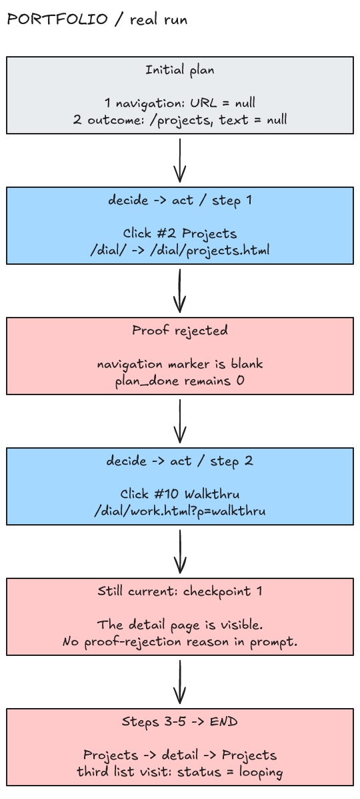
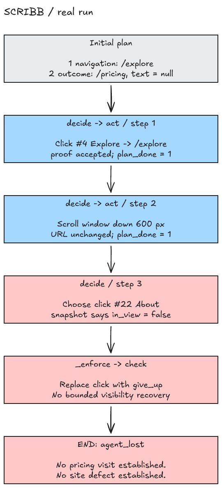
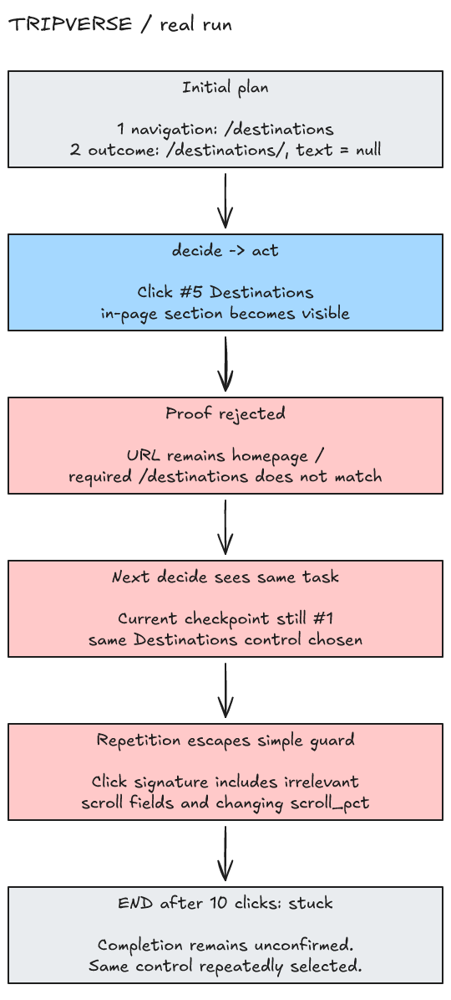
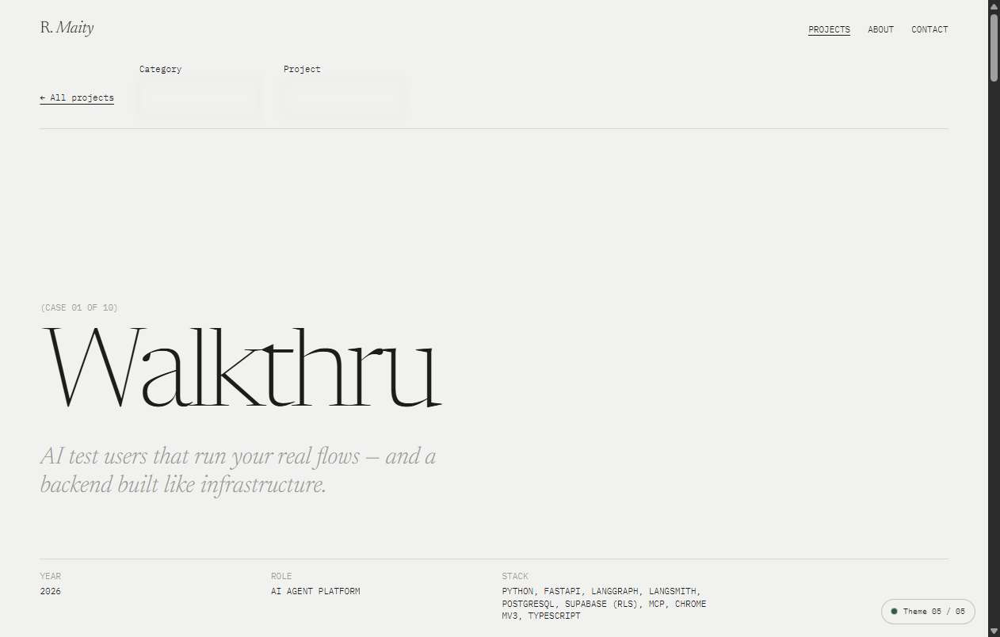
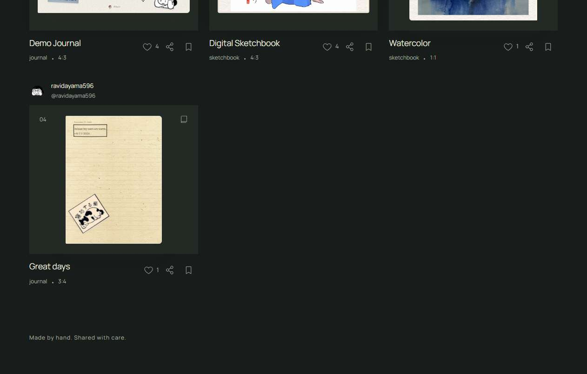

# When the browser succeeds but the agent cannot finish

WALKTHRU · ENGINEERING CASE STUDY

An instrumented audit of LangGraph state, browser actions, completion proofs, report generation and SEO/GEO claims.

13 November 2026 | Live public websites | Free model chain | Evidence edition

Figure 1. Baseline portfolio step 2 reached the Walkthru project detail page. The graph still recorded zero completed checkpoints.

### Abstract

Three baseline journeys were run against Portfolio, Scribb and Tripverse and saved privately in the requested Walkthru account. All three ended without confirmed completion. The traces distinguish observed browser progress from the graph’s completion contract: a blank navigation matcher, invented route expectations, a navigation task typed as a functional outcome, and an off-screen target selected despite an explicit visibility flag. These failures can occur even when browser controls work. The report pipeline often limits the resulting harm by withholding unsupported UX findings. Separate deterministic SEO/GEO rules still make some claims stronger than their measurements justify. Controlled follow-ups and replay checks test the most direct repair, while preserving raw prompts, state snapshots, tool results and screenshot evidence.

## 1. Scope, method and reproducibility

This is a small engineering case study, not a benchmark of general model reliability. The evaluator selected representative visitor goals; the user supplied the three sites and authorized saving runs in their account. The pricing goal for Scribb was not verified as an offered feature before the first run. That limits conclusions about task feasibility; it does not invalidate the observed planner and visibility defects. A second Scribb goal uses the Demo Journal control observed during the baseline.

The local cloud-runner implementation launched disposable headless Chromium sessions and loaded the repository’s built inject.js. It called the normal run-admission, graph-resume, screenshot-storage and report-persistence logic. Real free models chose actions. Existing server-side verification and visitor restrictions remained in force. A temporary development Plus entitlement enabled all three domains without payment; the evaluation scripts revoke their longer-lived temporary passes on completion.

The harness called internal API handlers rather than exercising browser login, HTTP authentication, cloud queue leasing or the deployed worker. The report job was captured and executed in the same instrumented process. Its actual report graph, scans and database writes ran. Thus the evidence establishes application-logic execution and private saved runs, not production deployment acceptance. Report email was disabled. The supplied email was used to identify the account and is omitted from this publication copy.

Captured artifacts include every application-level browser snapshot/act/evidence call, every model prompt and parsed response, provider attempts, graph node inputs/outputs, proof checks, post-action JPEGs, selected pre-action aim frames, final graph state and saved report JSON. Diagnostic follow-ups additionally log synchronous httpx method, URL path, status and latency. Baseline network transport was not fully traced; browser subresource requests and all asynchronous provider traffic are not a complete packet capture. Screenshots document rendered UI; they are not what the controller model saw.

LangGraph interrupt callbacks are logged as node_error by the generic callback. Interrupt(value=...) in these logs is the expected pause before the browser acts, not a failed node. A resumed act node starts again and returns once its observation arrives. Counting these starts as independent clicks would double-count tool execution.

The repository was dirty before the audit and contained ongoing cloud-runner work. source-manifest.json records the inspected source hashes and Git base; function-inventory.json indexes declarations and statically observed calls. An index entry does not mean the function executed. The paper identifies runtime-observed facts separately from source-review findings and proposed changes. The full HTML appendix preserves exact evidence and account report IDs.

## 2. Results and saved runs

Run / condition | Terminal state | Steps | Elapsed journey | Report
portfolio | looping | 5 | 85.59 s | saved
scribb | agent_lost | 3 | 60.43 s | saved
tripverse | stuck | 10 | 165.33 s | saved
portfolio-grounded | agent_lost | 6 | 103.62 s | saved
scribb-supported | agent_lost | 6 | 66.44 s | saved
portfolio-fixed-route | done | 2 | 35.57 s | saved

Step counts are saved decision records, including a terminal give_up where present. Journey elapsed time includes browser setup, admission, provider waits and persistence; the report phase follows it. The three baselines are not interchangeable tasks and the follow-ups are diagnostic experiments, not repeated trials. No success-rate estimate is warranted.

portfolio: Find the projects section and open one project detail on this website.

Saved report: /app/runs/82b4b12715f84cee95a3644d83a59c95

scribb: Find what Scribb offers and open its pricing or plans page.

Saved report: /app/runs/6cf033c601a74461ab9bad048bb07d07

tripverse: Find the destinations or trips listing and open one destination or trip detail.

Saved report: /app/runs/18012b2c8f0f46b08eed68c14226dd57

portfolio-grounded: Find the projects section and open one project detail on this website.

Saved report: /app/runs/df76f76f5ab4435cbd29375459d577f9

scribb-supported: Open Explore and open the Demo Journal.

Saved report: /app/runs/25544b01979342a7af25dbd701845ec0

portfolio-fixed-route: Find the projects section and open one project detail on this website.

Saved report: /app/runs/7f4bfdcb6ad84e2f8565b2d421564cb6

Two early attempts ended before a saved run was created: portfolio browser startup failed once, and Tripverse hit the original two-site entitlement limit. Those are admission/startup incidents, not agent task failures. The first browser exception was not captured in enough detail to assign a root cause. A retry reached the website successfully.

The application selects the active entitlement with the latest expiry, not necessarily the highest plan. A one-day Plus grant was initially outranked by the existing longer Pro pass. The audit therefore used a specifically identified longer development entitlement and revoked that row after the experiment. This behavior deserves an entitlement-selection regression test; it is distinct from model quality.

## 2a. Follow-ups that refine the diagnosis

The first portfolio intervention reused /dial/ routes from the baseline, but a fresh visit to the homepage redirected to /ledger/. The browser again opened a project detail; the reused predicates rejected it. The controller even tried switching themes to satisfy the stale route. This is a failed intervention and direct evidence that route grounding must be scoped to the current run, not copied from an earlier theme. The final controlled experiment starts explicitly at the observed /dial/ route to isolate predicate validity; it is not a test of autonomous route discovery.

The supported Scribb follow-up opened Demo Journal at step 2, revisited it at step 5, and ended agent_lost at step 6. Its last checkpoint was outcome with neither a route nor text expectation. This removes the baseline pricing-feasibility ambiguity: even an available, successfully opened feature could not satisfy the generated contract.

The final portfolio experiment starts at /dial/ and replaces the generated plan with navigation predicates for /dial/projects.html and /dial/work.html. Both come from the baseline browser evidence. The real controller and validator then complete the task in two steps, confirming both milestones. In contrast, the baseline reaches the same detail route but never advances its null-matcher first checkpoint. The experiment demonstrates that valid predicates can remove this specific blockage; autonomous discovery of those predicates still needs implementation.

Comparison | What it establishes | What it does not establish
Baseline vs recorded replay | The recorded transitions can satisfy grounded navigation predicates. | No new model behavior is tested by replay.
Baseline vs /ledger/ intervention | A stale route copied from another theme remains a bad contract. | Not evidence that the site must use /dial/.
Baseline vs fixed /dial/ run | Same goal, valid predicates and a matched start route completed in two actions. | Not a population success rate or general autonomous repair.
Scribb pricing vs Demo Journal | An available journal flow also exposes outcome misclassification. | No conclusion that a pricing page exists or is missing site-wide.

Provider fallbacks varied across attempts. Temperature zero does not make the environment deterministic: redirects, public content, timing and provider availability can change. The scripts log those differences rather than hiding failed interventions. A release decision still needs repeated trials with fixed tasks and negative completion controls.

## 3. The complete execution path

There are two LangGraph graphs. Goal planning, admission, browser execution, storage and job dispatch surround them. Treating every service as a graph node obscures which component actually decides the next step.

Stage | Input -> output / implementation
Admission | Account, site, goal, plan and policy -> authorized run; main._start_run, plans, quotes, reservations, ownership checks.
Planner | Goal + initial rendered text snapshot (5,000-character cut) -> GoalPlan; goal.plan, runtime.call(GoalPlan).
Persona graph | START -> decide. decide -> act for browser actions; decide -> check for done/give_up. act -> check. check -> decide if running, otherwise END.
Browser boundary | act interrupts with step. Runner calls inject.js, captures screenshot and fresh snapshot, then main._observe resumes with observation/evidence/action_id.
Completion | goal.evidence checks ordered public milestones. check updates plan_done and proof list; safety, budget and repetition rules can terminate.
Report handoff | _finish_later serializes selected graph state into finish_run job. finish_run reads saved run, rechecks verification and invokes report graph.
Report graph | START fans out to first_impression, accessibility_scan, site_scan, stack_scan. site_scan -> performance_scan. All four branch ends join synthesize -> END.
Persistence / viewing | db.set_report, private evidence Storage, in-app notification, optional email; React report reads saved account data.

Editable complete architecture: walkthru-agent-flowchart.excalidraw and its SVG export. The companion walkthru-agent.excalidraw contains the deeper state/context panels. live-traces.excalidraw adds the observed failure paths. These are source-inspection maps; only the recorded paths in the appendix are asserted as executed.

## 4. What survives from the previous state

State / context | What the next decision receives | Limit or consequence
goal + plan | Original objective, planner intent, ordered checklist and declared evidence matchers. | The current checklist item dominates action selection even when its predicate is impossible.
plan_done + proof | Code-owned completion count; proof entries also appear in history. | Model progress is overwritten. An earlier unprovable checkpoint blocks later proofs.
observation | Current URL/title, errors/notices, controls with IDs/context/visibility, scroll containers, executor result, public text. | Text is cut to 4,000 characters; snapshots have bounded element/context coverage. No screenshot pixels enter this controller.
steps / render_history | Last eight factual actions; old milestones and up to four earlier unresolved actions; bounded to 6,000 characters. | Target labels are stored but absent from the usual rendered history. Old #IDs are document-local and can be misleading after navigation.
Policy and persona | Verified/visitor constraints, task priority, test identity, persona preferences. | Instructions say not to select hidden controls, but selection is still unconstrained model output.
Memory / checkpoint | run_id thread plus LangGraph saver retains state across interrupts; default in-memory or configured Postgres saver. | Persistence is not semantic repair. A saved invalid plan remains invalid. No vector recall/RAG is used in this loop.
Report payload | status, steps, tokens, first_text, plan; final observation reduced to controls. | Full final snapshot and intermediate states are not passed to the report. Source review found assertion fields omitted at this boundary.

The central defect is not simply “too little memory.” The controller receives fresh page data, but it also receives a stale or unprovable instruction to keep working on the current checkpoint. The proof function returns only a proof object or None. The next prompt lacks a structured explanation such as missing_navigation_marker, route_mismatch, or missing_outcome_expectation, and lacks a defined repair transition.

### Expected state repair

Add code-owned checkpoint validation and proof diagnostics before another decision: checkpoint_id, evidence_kind, provenance, last_observation_revision, match_result, rejection_reason, attempted_action_signature and recovery_count. Preserve the original goal. A missing expectation should enter needs_expectation or bounded discovery, not a normal execution loop. A genuinely observed navigation destination may be bound from an observed link or selected target; it must not be invented from its label.

## 5. External services and tool boundaries

Component | Role and evidence boundary
Chromium + CDP + inject.js | Browser renders public site; snapshot/redact extracts text and controls; execute applies one action; axe and web-vitals capture browser diagnostics. JPEGs are evidence, not controller vision.
Groq | Observed baseline successes use openai/gpt-oss-120b and openai/gpt-oss-20b. Rate-limit errors triggered fallback. Exact provider attempts and timing appear in events.
Gemini / OpenRouter | Configured fallback alternatives in runtime.free_pool; availability does not prove use. OpenRouter is inserted for writer calls when configured. Consult per-run provider events.
Jev / paid candidates | Optional decision adapters in source. This evaluation forces the existing LLM/free path and disables paid candidate settings. No conclusion about Jev or Claude follows from these runs.
Supabase / Postgres | Account lookup, entitlements, run rows, private screenshot objects, report rows and notifications. LangGraph saver is a separate persistence concern.
Site HTTP / robots / sitemap | Shared SSRF-safe bounded crawler feeds SEO, GEO and passive hygiene. Coverage and failures must be read per report. No repository source is fetched.
PageSpeed Insights / CrUX | Optional performance integration; missing service results may coexist with browser vitals. checks.performance=complete is not evidence of a successful Lighthouse response.
DNS-over-HTTPS | Email DNS and other passive DNS checks; a DNS observation is not a delivery test or evidence of an exploit.
LangSmith / usage ledger | Optional tracing and provider accounting infrastructure. Local audit events are the evidence of record here; no claim that every span arrived in LangSmith.
Resend / Dodo | Email delivery and billing integrations exist outside the task loop. Report email was suppressed; no payment was submitted.

## 6. Exact fixes, evidence and acceptance criteria

The following changes are proposed engineering work. The audit harness does not ship them into product source. Priority reflects ability to explain these failures, not a claim about every failure in production.

### F1 / P0 · Planner emits unprovable checkpoints

Evidence: Observed in all baselines. Portfolio checkpoint 1 is navigation with no URL matcher; checkpoint 2 is outcome with no text expectation. Tripverse invents /destinations for an in-page section. Scribb invents /pricing and marks a page-opening goal as outcome with null text.

Location: goal.plan; goal.evidence; schema.GoalPlan; persona.system_prompt

Change: Validate a typed navigation/section/functional contract before execution. Ground hrefs in observed controls (currently the controller element model does not expose destinations). Represent same-page section visibility separately from business outcomes. Preserve unknown functional expectations as unknown. Add bounded discovery or request owner expectations when needed.

Acceptance: Recorded portfolio replay must accept the two real navigation transitions with grounded predicates; missing or invented matchers must never be run as a normal current checkpoint. Negative test: a generic toast or mere scroll cannot prove signup/send/save.

### F2 / P0 · Proof rejection is lost before the next decision

Evidence: Portfolio reached its detail page at step 2 but plan_done stayed zero. The next prompt demanded checkpoint 1 again; later visits tripped looping.

Location: persona.act/check; goal.evidence; render_history

Change: Return structured proof reasons and add a bounded plan-repair branch. Distinguish completed destination, missing expectation, route mismatch, execution refusal and unobserved effect. Do not ask the model to overwrite proof counts.

Acceptance: Using the recorded step-2 state, the next decision must receive the rejected predicate and reason and must not revisit Projects solely to satisfy an impossible plan.

### F3 / P1 · Off-screen choice terminates without recovery

Evidence: Scribb selected #22 About while in_view=false after scrolling. _enforce replaced the click with give_up and agent_lost. The refusal is safe; the missing recovery makes the agent brittle.

Location: persona._enforce; render_observation; extension snapshot/navigation

Change: Filter executable targets to current visible unobstructed controls, or reject with structured feedback and one bounded scroll/reobserve recovery. Recheck revision and visibility after movement. Never dispatch the refused click blindly.

Acceptance: Replay the saved Scribb choice: no hidden click executes; one bounded observation/navigation recovery is allowed; repeated failure terminates as agent limitation.

### F4 / P1 · Loop signature includes parameters irrelevant to clicks

Evidence: Tripverse clicked Destinations ten times. scroll_container_id alternated null and 0, although the action was click. Once three consecutive signatures matched, check returned stuck.

Location: persona.check: keys built for tail; _lost

Change: Normalize action signatures by action type. For click use stable current-document target identity/label and outcome fingerprint; omit scroll/wait options. Track repeated attempts against the same unresolved checkpoint and unchanged semantic result.

Acceptance: Equivalent clicks differing only by scroll_container_id must count toward one retry limit. Real list scrolling and changed content must not be mistaken for repeated clicks.

### F5 / P1 · Report wording sometimes exceeds deterministic evidence

Evidence: SEO says missing alt makes images invisible to search engines; thin content “rarely” ranks; GEO turns paragraph-length tests into semantic claims. These strings come from code, not a hallucinatory report model.

Location: scans/seo.py; seo_depth.py; geo.py; email.py

Change: Separate observed measurement, heuristic interpretation and verified impact. Replace absolute claims; label GEO scoring advisory. Preserve existing honest uncertainty for optional AI text files. Do not infer email failure from absent MX alone.

Acceptance: Golden report fixtures must distinguish absent attribute/low word count from ranking prediction, citation likelihood, actual mail failure or verified site defect.

### F6 / P1 · Report handoff drops declared assertion fields

Evidence: Source-review finding: _finish_later keeps status/steps/tokens/first_text/plan; finish_run reads assertion/assertion_outcome from the payload. These visitor runs did not exercise owner assertions.

Location: main._finish_later and main.finish_run

Change: Include validated assertion and assertion_outcome in the persisted job contract; add a job round-trip test. Preserve missing-as-unknown semantics.

Acceptance: Queue an owner assertion run, deserialize its report job and verify the exact expectation/outcome reaches assessment without inference.

### F7 / P2 · Observability can misidentify error, cost and provider

Evidence: Expected LangGraph interrupts look like node errors in a generic callback; legacy report tokens omit the planner call; report.model is a configured label rather than proof of the model that answered.

Location: runtime.call/guarded; goal.plan; report.synthesize; provider_usage

Change: Emit explicit interrupt/resume spans, stage/provider/model receipts and complete token accounting. Keep successful and failed provider attempts separate. Prefer receipts over nominal model labels.

Acceptance: One live run must reconcile planner + decisions + first impression + synthesis usage, including fallback attempts, and distinguish expected pauses from errors.

### F8 / P1 · Synthesis amplifies scanner claims in the summary

Evidence: The successful portfolio report says accessibility violations block screen readers and AI crawlers see empty pages. The audit did not test every assistive technology or answer engine.

Location: report.SYNTHESIS_SYSTEM; synthesize; summary/top_fixes contract

Change: Carry evidence scope and uncertainty into every summary assertion, not only ux_findings. Use evidence-bound summary items or deterministic rendering for categorical measurements.

Acceptance: Given the saved final report inputs, no summary may convert a static heuristic or scoped axe finding into a universal user-impact claim; every impact statement must have an appropriate supporting source.

## 7. Prompt audit: planning, decisions and reports

Prompt stage | What was actually provided | Assessment
GoalPlan | Original goal + rendered initial snapshot; planner prompt allows null expectations when unknown. | Good: avoids inventing finish phrases in its text rule. Gap: null and guessed URL predicates still pass into an execution checklist. The code grounds text_contains but not url_contains.
PersonaStep | System objective/checklist/persona/safety + bounded factual history/current snapshot; one correction for unsupported done/give_up. | Good: original objective is authoritative and progress is code-owned. Gap: no proof rejection reason, missing href provenance, all visible/offscreen IDs offered in one list, no repair transition.
FirstImpression | Up to 5,000 characters of first page text; instructions prohibit visual/layout/color claims. | This is a text impression, not a screenshot design review. First page may be a redirect destination. Keep the input type explicit.
Synthesis | Measured findings, final controls, journey facts, scope and evidence references; grounded_ux filters supported issues. | Baseline runs skipped the model when unfinished without observed failure and used a deterministic summary. That protection worked.
SEO / GEO | There is no dedicated SEO or GEO model prompt in this graph. Scanners produce findings and scores from HTTP/HTML/robots/schema data. | Prompt-only changes will not repair misleading scanner strings or score assumptions. Fix the deterministic rule and evidence contract.

Full exact prompts and parsed outputs are in trace-appendix.html. These are observable model I/O, including the returned think-aloud field; they are not access to a model’s hidden reasoning. The follow-up planner substitution is recorded explicitly as experimental_intervention, with the original proposal and replacement.

### Proposed controller input contract

Owner objective; current validated checkpoint; evidence provenance; completion predicate; last action and actual effect; rejection reason; executable targets; other visible sections; unresolved safe alternatives; recovery budget. Keep page text marked untrusted. Give the model an explicit recover/reobserve choice when an action is refused, while code retains authority over safety and completion.

## 8. SEO, GEO and report interpretation

The baseline reports saved 22 findings for Portfolio, 15 for Scribb and 17 for Tripverse. These are rule outputs, not 54 independently proven defects. Reports correctly kept UX findings empty and said completion was unconfirmed. Browser LCP/CLS were identified as single-visit measurements, distinct from population field data or Lighthouse. These are useful grounding controls.

Claim under review | What the measurement supports | Required wording / reference
Missing alt -> images invisible to search | An img attribute is absent in fetched HTML. | Say that useful text alternatives are missing. Google also uses computer vision and page content. [R1]
Low word count -> pages rarely rank | Fetched HTML contains approximately N words. | Report scope and possible content gap, not a ranking prediction. Google has no magical word-count target. [R2]
No long early paragraph -> no plain answer | A length threshold on the first paragraphs failed. | Label it a formatting heuristic. It does not establish whether the text answers a question or will be cited.
Optional AI text files | File absent or HTML returned. | The existing “effect not established” qualification is appropriate. Google requires no special AI text files for its AI features. [R3]
No MX -> domain cannot receive email | No MX response from the resolver. | Do not assert delivery failure; SMTP defines an implicit MX fallback to the host when no MX records exist. [R4]
No og:title -> no title or image preview | Only the og:title selector is absent. | Check title/description/image independently; report absent metadata, not guaranteed platform output.
High GEO/launch score -> successful task | Rule-weighted readiness scores over sampled pages. | Keep task completion, indexability, citation visibility and advisory score separate. Scribb scored 95 GEO while the journey ended agent_lost.

These source-based corrections do not prove a particular site ranks, receives mail, or appears in AI answers. They narrow the claims to what was measured. Primary references were consulted on 13 November 2026; only short paraphrases are used. Google guidance here applies to Google Search, not every answer engine.

The successful matched-route run did invoke Synthesis. Its summary says accessibility violations “block screen readers” and that AI crawlers and link previews see empty pages. Those broad impacts were not directly tested. This shows a second amplification boundary: even when the journey is correctly marked done, a writer can turn scoped scanner findings into categorical impact statements. Require the synthesis summary to preserve the same uncertainty and scope as each evidence source; filtering ux_findings alone does not constrain every sentence in summary or top_fixes.

## 9. Observed traces and screenshots

Each run below includes its exact planner contract, terminal interpretation, provider attempts and every saved step. The image on a step page is its post-action frame; pre-action aim frames are available in the HTML appendix. Terminal decisions may have only a final captured view. A frame is evidence of the viewport at capture time, not proof of backend state.

For complete input/output data at every node, expand the corresponding event in trace-appendix.html. JSONL event order records callback arrival; concurrent report branches can overlap. Explicit node invocation IDs connect starts and ends. Screenshot hashes are listed in evidence-hashes.json.

## Portfolio / observed graph path

Observed baseline path. The complete editable diagram is live-traces.excalidraw.

## Scribb / observed graph path

Observed baseline path. The complete editable diagram is live-traces.excalidraw.

## Tripverse / observed graph path

Observed baseline path. The complete editable diagram is live-traces.excalidraw.

## Portfolio / run breakdown

Find the projects section and open one project detail on this website.

Run 82b4b12715f84cee95a3644d83a59c95 | saved status looping | confirmed checkpoints 0/2

Checkpoint | Kind | URL predicate | Text predicate
Click the "Projects" link in the main navigation to reveal the projects section. | navigation | None | None
Open the detail page of the first listed project (e.g., by clicking its title or image). | outcome | /projects | None

Saved report summary: The journey stopped early with 5 browser actions with recorded outcomes. Journey completion was not confirmed, and no observed journey failure was established. Automated checks produced 22 findings; review their evidence and coverage separately.

Successful provider attempts: openai/gpt-oss-120b: 5, openai/gpt-oss-20b: 2. Provider errors: 2.

Report scan coverage: 8 pages; GEO advisory score 45. Saved token total 18762 (legacy total; planner usage is separately recorded).

Synthesis model call: not observed; unfinished/no-failure deterministic branch.

## portfolio / step 1

CLICK · Projects

Before: https://portfolio2-mu-inky.vercel.app/dial/
After: https://portfolio2-mu-inky.vercel.app/dial/projects.html

Figure portfolio-01. Clicked "Projects".

The Projects link navigated successfully. The declared navigation matcher was null, so proof was rejected and progress remained zero.

Input to this decision: plan_done=0; current checkpoint="Click the "Projects" link in the main navigation to reveal the projects section."; kind=navigation; URL matcher=None; text matcher=None.

Proof: No new checkpoint proof attached.
Recorded progress before action: 0; terminal code: none.

Model/executor record: I need to open the Projects section, so I'll click the Projects link in the navigation.

## portfolio / step 2

CLICK · Walkthru

Before: https://portfolio2-mu-inky.vercel.app/dial/projects.html
After: https://portfolio2-mu-inky.vercel.app/dial/work.html?p=walkthru

Figure portfolio-02. Clicked "Walkthru".

The requested project detail is visible. The ordered proof loop still tests checkpoint 1 and stops at its missing matcher; it never gets to validate checkpoint 2.

Input to this decision: plan_done=0; current checkpoint="Click the "Projects" link in the main navigation to reveal the projects section."; kind=navigation; URL matcher=None; text matcher=None.

Previous recorded action: click #2; result_url=https://portfolio2-mu-inky.vercel.app/dial/projects.html. The next model also receives the bounded history and current control snapshot preserved in the appendix.

Proof: No new checkpoint proof attached.
Recorded progress before action: 0; terminal code: none.

Model/executor record: I see the first project listed as "Walkthru" with a link element 10. Clicking it should open the project detail page.

## portfolio / step 3

CLICK · Projects

Before: https://portfolio2-mu-inky.vercel.app/dial/work.html?p=walkthru
After: https://portfolio2-mu-inky.vercel.app/dial/projects.html

Figure portfolio-03. Clicked "Projects".

The controller revisits Projects because the current checklist still says checkpoint 1. This reverses useful progress.

Input to this decision: plan_done=0; current checkpoint="Click the "Projects" link in the main navigation to reveal the projects section."; kind=navigation; URL matcher=None; text matcher=None.

Previous recorded action: click #10; result_url=https://portfolio2-mu-inky.vercel.app/dial/work.html?p=walkthru. The next model also receives the bounded history and current control snapshot preserved in the appendix.

Proof: No new checkpoint proof attached.
Recorded progress before action: 0; terminal code: none.

Model/executor record: I need to go back to the Projects navigation link to see the projects list.

## portfolio / step 4

CLICK · Walkthru

Before: https://portfolio2-mu-inky.vercel.app/dial/projects.html
After: https://portfolio2-mu-inky.vercel.app/dial/work.html?p=walkthru

Figure portfolio-04. Clicked "Walkthru".

The same project detail is reached again. The snapshot contains useful site content, but the completion contract remains unchanged.

Input to this decision: plan_done=0; current checkpoint="Click the "Projects" link in the main navigation to reveal the projects section."; kind=navigation; URL matcher=None; text matcher=None.

Previous recorded action: click #2; result_url=https://portfolio2-mu-inky.vercel.app/dial/projects.html. The next model also receives the bounded history and current control snapshot preserved in the appendix.

Proof: No new checkpoint proof attached.
Recorded progress before action: 0; terminal code: none.

Model/executor record: The first project listed is Walkthru. I’ll click its link to open the detail page.

## portfolio / step 5

CLICK · Projects

Before: https://portfolio2-mu-inky.vercel.app/dial/work.html?p=walkthru
After: https://portfolio2-mu-inky.vercel.app/dial/projects.html

Figure portfolio-05. Clicked "Projects".

The third visit to the project list triggers looping. The stopping guard is effective at bounding the run; it does not identify the earlier contract defect.

Input to this decision: plan_done=0; current checkpoint="Click the "Projects" link in the main navigation to reveal the projects section."; kind=navigation; URL matcher=None; text matcher=None.

Previous recorded action: click #10; result_url=https://portfolio2-mu-inky.vercel.app/dial/work.html?p=walkthru. The next model also receives the bounded history and current control snapshot preserved in the appendix.

Proof: No new checkpoint proof attached.
Recorded progress before action: 0; terminal code: none.

Model/executor record: I need to go to the Projects section, so I'll click the Projects link in the main navigation.

## Scribb / run breakdown

Find what Scribb offers and open its pricing or plans page.

Run 6cf033c601a74461ab9bad048bb07d07 | saved status agent_lost | confirmed checkpoints 1/2

Checkpoint | Kind | URL predicate | Text predicate
Open the Explore section to view Scribb's offerings. | navigation | /explore | None
Open the pricing or plans page. | outcome | /pricing | None

Saved report summary: The journey stopped early with 2 browser actions with recorded outcomes. Journey completion was not confirmed, and no observed journey failure was established. Automated checks produced 15 findings; review their evidence and coverage separately.

Successful provider attempts: openai/gpt-oss-120b: 4, openai/gpt-oss-20b: 1. Provider errors: 1.

Report scan coverage: 9 pages; GEO advisory score 95. Saved token total 10867 (legacy total; planner usage is separately recorded).

Synthesis model call: not observed; unfinished/no-failure deterministic branch.

## scribb / step 1

CLICK · Explore

Before: https://www.scribb.xyz/
After: https://www.scribb.xyz/explore

Figure scribb-01. Clicked "Explore".

A real navigation to /explore confirms checkpoint 1. The remaining pricing task has an unsupported route expectation and no functional finish text.

Input to this decision: plan_done=0; current checkpoint="Open the Explore section to view Scribb's offerings."; kind=navigation; URL matcher=/explore; text matcher=None.

Proof: {
  "url": "https://www.scribb.xyz/explore",
  "step": 1,
  "signal": "navigation",
  "matched": "/explore",
  "checkpoint": 1
}
Recorded progress before action: 0; terminal code: none.

Model/executor record: I'm impatient, just click the Explore button to see what Scribb offers.

## scribb / step 2

SCROLL

Before: https://www.scribb.xyz/explore
After: https://www.scribb.xyz/explore

Figure scribb-02. Scrolled down.

The browser moved down 600 pixels. This is observation/navigation progress, not pricing completion. The page then marks About outside the viewport.

Input to this decision: plan_done=1; current checkpoint="Open the pricing or plans page."; kind=outcome; URL matcher=/pricing; text matcher=None.

Previous recorded action: click #4; result_url=https://www.scribb.xyz/explore. The next model also receives the bounded history and current control snapshot preserved in the appendix.

Proof: No new checkpoint proof attached.
Recorded progress before action: 1; terminal code: none.

Model/executor record: I need to find a pricing or plans link; it's probably lower on the page or in the footer, so I'll scroll down.

## scribb / step 3

GIVE_UP

Before: https://www.scribb.xyz/explore
After: https://www.scribb.xyz/explore

Figure scribb-03. Stopped here.

The model requested click #22 About. Deterministic enforcement refused the off-screen target and changed the action to give_up; no About click was dispatched. The final frame records the stopping location.

Input to this decision: plan_done=1; current checkpoint="Open the pricing or plans page."; kind=outcome; URL matcher=/pricing; text matcher=None.

Previous recorded action: scroll #0; result_url=https://www.scribb.xyz/explore. The next model also receives the bounded history and current control snapshot preserved in the appendix.

Proof: No new checkpoint proof attached.
Recorded progress before action: 0; terminal code: agent_lost.

Model/executor record: I need to get to the pricing page. The Explore page doesn't show a pricing link, so I'll try the About page first. (Walkthru target unavailable in the current viewport.)

## Tripverse / run breakdown

Find the destinations or trips listing and open one destination or trip detail.

Run 18012b2c8f0f46b08eed68c14226dd57 | saved status stuck | confirmed checkpoints 0/2

Checkpoint | Kind | URL predicate | Text predicate
Open the Destinations page from the main navigation. | navigation | /destinations | None
Select any destination or trip from the listing to view its detail page. | outcome | /destinations/ | None

Saved report summary: The journey stopped early with 10 browser actions with recorded outcomes. Journey completion was not confirmed, and no observed journey failure was established. Automated checks produced 17 findings; review their evidence and coverage separately.

Successful provider attempts: openai/gpt-oss-120b: 8, openai/gpt-oss-20b: 4. Provider errors: 4.

Report scan coverage: 1 pages; GEO advisory score 42. Saved token total 39560 (legacy total; planner usage is separately recorded).

Synthesis model call: not observed; unfinished/no-failure deterministic branch.

## tripverse / step 1

CLICK · Destinations

Before: https://tripverse-0.vercel.app/
After: https://tripverse-0.vercel.app/

Figure tripverse-01. Clicked "Destinations".

The first click reveals the Destinations section while leaving the URL at /. The invented /destinations matcher rejects this useful progress.

Input to this decision: plan_done=0; current checkpoint="Open the Destinations page from the main navigation."; kind=navigation; URL matcher=/destinations; text matcher=None.

Proof: No new checkpoint proof attached.
Recorded progress before action: 0; terminal code: none.

Model/executor record: I need to open the Destinations page, so I'll click the Destinations link in the primary navigation.

## tripverse / step 2

CLICK · Destinations

Before: https://tripverse-0.vercel.app/
After: https://tripverse-0.vercel.app/

Figure tripverse-02. Clicked "Destinations".

The same Destinations control is selected again while the current checkpoint remains unconfirmed. No destination detail is opened. Irrelevant scroll_container_id variations prevent early identical-action detection; the final repeated signature eventually stops as stuck.

Input to this decision: plan_done=0; current checkpoint="Open the Destinations page from the main navigation."; kind=navigation; URL matcher=/destinations; text matcher=None.

Previous recorded action: click #5; result_url=https://tripverse-0.vercel.app/. The next model also receives the bounded history and current control snapshot preserved in the appendix.

Proof: No new checkpoint proof attached.
Recorded progress before action: 0; terminal code: none.

Model/executor record: I need to open the Destinations page from the main navigation, so I'll click the Destinations link.

## tripverse / step 3

CLICK · Destinations

Before: https://tripverse-0.vercel.app/
After: https://tripverse-0.vercel.app/

Figure tripverse-03. Clicked "Destinations".

The same Destinations control is selected again while the current checkpoint remains unconfirmed. No destination detail is opened. Irrelevant scroll_container_id variations prevent early identical-action detection; the final repeated signature eventually stops as stuck.

Input to this decision: plan_done=0; current checkpoint="Open the Destinations page from the main navigation."; kind=navigation; URL matcher=/destinations; text matcher=None.

Previous recorded action: click #5; result_url=https://tripverse-0.vercel.app/. The next model also receives the bounded history and current control snapshot preserved in the appendix.

Proof: No new checkpoint proof attached.
Recorded progress before action: 0; terminal code: none.

Model/executor record: I need to go to the Destinations page. The Destinations link is element 5.

## tripverse / step 4

CLICK · Destinations

Before: https://tripverse-0.vercel.app/
After: https://tripverse-0.vercel.app/

Figure tripverse-04. Clicked "Destinations".

The same Destinations control is selected again while the current checkpoint remains unconfirmed. No destination detail is opened. Irrelevant scroll_container_id variations prevent early identical-action detection; the final repeated signature eventually stops as stuck.

Input to this decision: plan_done=0; current checkpoint="Open the Destinations page from the main navigation."; kind=navigation; URL matcher=/destinations; text matcher=None.

Previous recorded action: click #5; result_url=https://tripverse-0.vercel.app/. The next model also receives the bounded history and current control snapshot preserved in the appendix.

Proof: No new checkpoint proof attached.
Recorded progress before action: 0; terminal code: none.

Model/executor record: I need to open the Destinations page from the main navigation, so I'll click the Destinations link.

## tripverse / step 5

CLICK · Destinations

Before: https://tripverse-0.vercel.app/
After: https://tripverse-0.vercel.app/

Figure tripverse-05. Clicked "Destinations".

The same Destinations control is selected again while the current checkpoint remains unconfirmed. No destination detail is opened. Irrelevant scroll_container_id variations prevent early identical-action detection; the final repeated signature eventually stops as stuck.

Input to this decision: plan_done=0; current checkpoint="Open the Destinations page from the main navigation."; kind=navigation; URL matcher=/destinations; text matcher=None.

Previous recorded action: click #5; result_url=https://tripverse-0.vercel.app/. The next model also receives the bounded history and current control snapshot preserved in the appendix.

Proof: No new checkpoint proof attached.
Recorded progress before action: 0; terminal code: none.

Model/executor record: I need to open the Destinations page from the main navigation.

## tripverse / step 6

CLICK · Destinations

Before: https://tripverse-0.vercel.app/
After: https://tripverse-0.vercel.app/

Figure tripverse-06. Clicked "Destinations".

The same Destinations control is selected again while the current checkpoint remains unconfirmed. No destination detail is opened. Irrelevant scroll_container_id variations prevent early identical-action detection; the final repeated signature eventually stops as stuck.

Input to this decision: plan_done=0; current checkpoint="Open the Destinations page from the main navigation."; kind=navigation; URL matcher=/destinations; text matcher=None.

Previous recorded action: click #5; result_url=https://tripverse-0.vercel.app/. The next model also receives the bounded history and current control snapshot preserved in the appendix.

Proof: No new checkpoint proof attached.
Recorded progress before action: 0; terminal code: none.

Model/executor record: I need to open the Destinations page from the main navigation.

## tripverse / step 7

CLICK · Destinations

Before: https://tripverse-0.vercel.app/
After: https://tripverse-0.vercel.app/

Figure tripverse-07. Clicked "Destinations".

The same Destinations control is selected again while the current checkpoint remains unconfirmed. No destination detail is opened. Irrelevant scroll_container_id variations prevent early identical-action detection; the final repeated signature eventually stops as stuck.

Input to this decision: plan_done=0; current checkpoint="Open the Destinations page from the main navigation."; kind=navigation; URL matcher=/destinations; text matcher=None.

Previous recorded action: click #5; result_url=https://tripverse-0.vercel.app/. The next model also receives the bounded history and current control snapshot preserved in the appendix.

Proof: No new checkpoint proof attached.
Recorded progress before action: 0; terminal code: none.

Model/executor record: I need to go to the Destinations page. The Destinations link is element 5.

## tripverse / step 8

CLICK · Destinations

Before: https://tripverse-0.vercel.app/
After: https://tripverse-0.vercel.app/

Figure tripverse-08. Clicked "Destinations".

The same Destinations control is selected again while the current checkpoint remains unconfirmed. No destination detail is opened. Irrelevant scroll_container_id variations prevent early identical-action detection; the final repeated signature eventually stops as stuck.

Input to this decision: plan_done=0; current checkpoint="Open the Destinations page from the main navigation."; kind=navigation; URL matcher=/destinations; text matcher=None.

Previous recorded action: click #5; result_url=https://tripverse-0.vercel.app/. The next model also receives the bounded history and current control snapshot preserved in the appendix.

Proof: No new checkpoint proof attached.
Recorded progress before action: 0; terminal code: none.

Model/executor record: I need to open the Destinations page from the main navigation.

## tripverse / step 9

CLICK · Destinations

Before: https://tripverse-0.vercel.app/
After: https://tripverse-0.vercel.app/

Figure tripverse-09. Clicked "Destinations".

The same Destinations control is selected again while the current checkpoint remains unconfirmed. No destination detail is opened. Irrelevant scroll_container_id variations prevent early identical-action detection; the final repeated signature eventually stops as stuck.

Input to this decision: plan_done=0; current checkpoint="Open the Destinations page from the main navigation."; kind=navigation; URL matcher=/destinations; text matcher=None.

Previous recorded action: click #5; result_url=https://tripverse-0.vercel.app/. The next model also receives the bounded history and current control snapshot preserved in the appendix.

Proof: No new checkpoint proof attached.
Recorded progress before action: 0; terminal code: none.

Model/executor record: I need to go to the Destinations page. The Destinations link is element 5.

## tripverse / step 10

CLICK · Destinations

Before: https://tripverse-0.vercel.app/
After: https://tripverse-0.vercel.app/

Figure tripverse-10. Clicked "Destinations".

The same Destinations control is selected again while the current checkpoint remains unconfirmed. No destination detail is opened. Irrelevant scroll_container_id variations prevent early identical-action detection; the final repeated signature eventually stops as stuck.

Input to this decision: plan_done=0; current checkpoint="Open the Destinations page from the main navigation."; kind=navigation; URL matcher=/destinations; text matcher=None.

Previous recorded action: click #5; result_url=https://tripverse-0.vercel.app/. The next model also receives the bounded history and current control snapshot preserved in the appendix.

Proof: No new checkpoint proof attached.
Recorded progress before action: 0; terminal code: none.

Model/executor record: I need to open the Destinations page from the main navigation.

## Portfolio Grounded / run breakdown

Find the projects section and open one project detail on this website.

Run df76f76f5ab4435cbd29375459d577f9 | saved status agent_lost | confirmed checkpoints 0/2

Checkpoint | Kind | URL predicate | Text predicate
Open the Projects page. | navigation | /dial/projects.html | None
Open a project detail page. | navigation | /dial/work.html | None

Saved report summary: The journey stopped early with 5 browser actions with recorded outcomes. Journey completion was not confirmed, and no observed journey failure was established. Automated checks produced 21 findings; review their evidence and coverage separately.

Successful provider attempts: openai/gpt-oss-120b: 4, openai/gpt-oss-20b: 2, qwen/qwen3.8-27b: 1, gemini-3.5-flash: 1, gemini-3.1-flash-lite: 1, nvidia/nemotron-3-ultra-550b-a55b:free: 1. Provider errors: 12.

Report scan coverage: 8 pages; GEO advisory score 45. Saved token total 36518 (legacy total; planner usage is separately recorded).

Synthesis model call: not observed; unfinished/no-failure deterministic branch.

## portfolio-grounded / step 1

CLICK · 02.Projects

Before: https://portfolio2-mu-inky.vercel.app/ledger/
After: https://portfolio2-mu-inky.vercel.app/ledger/projects.html

Figure portfolio-grounded-01. Clicked "02.Projects".

Failed intervention: the fresh run opened /ledger/, while the substituted plan still required /dial/ routes from the earlier baseline. The browser made useful progress but the contract stayed stale. This demonstrates that grounding must use the current run and current target, not prior-route memorization.

Input to this decision: plan_done=0; current checkpoint="Open the Projects page."; kind=navigation; URL matcher=/dial/projects.html; text matcher=None.

Proof: No new checkpoint proof attached.
Recorded progress before action: 0; terminal code: none.

Model/executor record: I need to go to the Projects page, so I'll click the '02.Projects' link in the navigation.

## portfolio-grounded / step 2

CLICK · Walkthru

Before: https://portfolio2-mu-inky.vercel.app/ledger/projects.html
After: https://portfolio2-mu-inky.vercel.app/ledger/work.html?p=walkthru

Figure portfolio-grounded-02. Clicked "Walkthru".

Failed intervention: the fresh run opened /ledger/, while the substituted plan still required /dial/ routes from the earlier baseline. The browser made useful progress but the contract stayed stale. This demonstrates that grounding must use the current run and current target, not prior-route memorization.

Input to this decision: plan_done=0; current checkpoint="Open the Projects page."; kind=navigation; URL matcher=/dial/projects.html; text matcher=None.

Previous recorded action: click #2; result_url=https://portfolio2-mu-inky.vercel.app/ledger/projects.html. The next model also receives the bounded history and current control snapshot preserved in the appendix.

Proof: No new checkpoint proof attached.
Recorded progress before action: 0; terminal code: none.

Model/executor record: I’ll open the first project detail by clicking the link for project 01 / 2026 AI · Backend Walkthru.

## portfolio-grounded / step 3

SCROLL

Before: https://portfolio2-mu-inky.vercel.app/ledger/work.html?p=walkthru
After: https://portfolio2-mu-inky.vercel.app/ledger/work.html?p=walkthru

Figure portfolio-grounded-03. Scrolled down.

Failed intervention: the fresh run opened /ledger/, while the substituted plan still required /dial/ routes from the earlier baseline. The browser made useful progress but the contract stayed stale. This demonstrates that grounding must use the current run and current target, not prior-route memorization.

Input to this decision: plan_done=0; current checkpoint="Open the Projects page."; kind=navigation; URL matcher=/dial/projects.html; text matcher=None.

Previous recorded action: click #10; result_url=https://portfolio2-mu-inky.vercel.app/ledger/work.html?p=walkthru. The next model also receives the bounded history and current control snapshot preserved in the appendix.

Proof: No new checkpoint proof attached.
Recorded progress before action: 0; terminal code: none.

Model/executor record: Need to see project links; scroll down.

## portfolio-grounded / step 4

CLICK · 02.Projects

Before: https://portfolio2-mu-inky.vercel.app/ledger/work.html?p=walkthru
After: https://portfolio2-mu-inky.vercel.app/ledger/projects.html

Figure portfolio-grounded-04. Clicked "02.Projects".

Failed intervention: the fresh run opened /ledger/, while the substituted plan still required /dial/ routes from the earlier baseline. The browser made useful progress but the contract stayed stale. This demonstrates that grounding must use the current run and current target, not prior-route memorization.

Input to this decision: plan_done=0; current checkpoint="Open the Projects page."; kind=navigation; URL matcher=/dial/projects.html; text matcher=None.

Previous recorded action: scroll #None; result_url=https://portfolio2-mu-inky.vercel.app/ledger/work.html?p=walkthru. The next model also receives the bounded history and current control snapshot preserved in the appendix.

Proof: No new checkpoint proof attached.
Recorded progress before action: 0; terminal code: none.

Model/executor record: We need a project detail page whose URL contains '/dial/work.html'. The current page is a work page but under '/ledger/'. Let's go back to the Projects list and pick another project that likely uses the expected path.

## portfolio-grounded / step 5

CLICK · Theme 02 / 05

Before: https://portfolio2-mu-inky.vercel.app/ledger/projects.html
After: https://portfolio2-mu-inky.vercel.app/ledger/projects.html

Figure portfolio-grounded-05. Clicked "Theme 02 / 05".

Failed intervention: the fresh run opened /ledger/, while the substituted plan still required /dial/ routes from the earlier baseline. The browser made useful progress but the contract stayed stale. This demonstrates that grounding must use the current run and current target, not prior-route memorization.

Input to this decision: plan_done=0; current checkpoint="Open the Projects page."; kind=navigation; URL matcher=/dial/projects.html; text matcher=None.

Previous recorded action: click #2; result_url=https://portfolio2-mu-inky.vercel.app/ledger/projects.html. The next model also receives the bounded history and current control snapshot preserved in the appendix.

Proof: No new checkpoint proof attached.
Recorded progress before action: 0; terminal code: none.

Model/executor record: The previous URL path /ledger/ didn't match the required dial theme. Let's switch themes using the Theme button.

## portfolio-grounded / step 6

GIVE_UP

Before: https://portfolio2-mu-inky.vercel.app/ledger/projects.html
After: https://portfolio2-mu-inky.vercel.app/ledger/projects.html

Figure portfolio-grounded-06. Stopped here.

Failed intervention: the fresh run opened /ledger/, while the substituted plan still required /dial/ routes from the earlier baseline. The browser made useful progress but the contract stayed stale. This demonstrates that grounding must use the current run and current target, not prior-route memorization.

Input to this decision: plan_done=0; current checkpoint="Open the Projects page."; kind=navigation; URL matcher=/dial/projects.html; text matcher=None.

Previous recorded action: click #11; result_url=https://portfolio2-mu-inky.vercel.app/ledger/projects.html. The next model also receives the bounded history and current control snapshot preserved in the appendix.

Proof: No new checkpoint proof attached.
Recorded progress before action: 0; terminal code: agent_lost.

Model/executor record: I am on the projects page and need to open a project detail page. I will click the 'Read case study' link for the first project to fulfill the objective. (Walkthru target unavailable in the current viewport.)

## Scribb Supported / run breakdown

Open Explore and open the Demo Journal.

Run 25544b01979342a7af25dbd701845ec0 | saved status agent_lost | confirmed checkpoints 1/2

Checkpoint | Kind | URL predicate | Text predicate
Click the "Explore" button on the home page. | navigation | /explore | None
On the Explore page, click the "Demo Journal" entry to open it. | outcome | None | None

Saved report summary: The journey stopped early with 5 browser actions with recorded outcomes. Journey completion was not confirmed, and no observed journey failure was established. Automated checks produced 15 findings; review their evidence and coverage separately.

Successful provider attempts: openai/gpt-oss-120b: 4, openai/gpt-oss-20b: 2, qwen/qwen3.8-27b: 1, gemini-3.1-flash-lite: 1, nvidia/nemotron-3-ultra-550b-a55b:free: 1. Provider errors: 9.

Report scan coverage: 9 pages; GEO advisory score 95. Saved token total 28351 (legacy total; planner usage is separately recorded).

Synthesis model call: not observed; unfinished/no-failure deterministic branch.

## scribb-supported / step 1

CLICK · Explore

Before: https://www.scribb.xyz/
After: https://www.scribb.xyz/explore

Figure scribb-supported-01. Clicked "Explore".

The public Explore page opened and checkpoint 1 was confirmed.

Input to this decision: plan_done=0; current checkpoint="Click the "Explore" button on the home page."; kind=navigation; URL matcher=/explore; text matcher=None.

Proof: {
  "url": "https://www.scribb.xyz/explore",
  "step": 1,
  "signal": "navigation",
  "matched": "/explore",
  "checkpoint": 1
}
Recorded progress before action: 0; terminal code: none.

Model/executor record: Okay, first thing is to click the Explore button to go to the explore page.

## scribb-supported / step 2

CLICK · Open Demo Journal

Before: https://www.scribb.xyz/explore
After: https://www.scribb.xyz/@zaxx/159f03a9-eb7f-4d83-894a-40a2572f2e25

Figure scribb-supported-02. Clicked "Open Demo Journal".

The Demo Journal destination is reached. The planner typed this page-opening task as outcome with no finish text, so code cannot confirm it.

Input to this decision: plan_done=1; current checkpoint="On the Explore page, click the "Demo Journal" entry to open it."; kind=outcome; URL matcher=None; text matcher=None.

Previous recorded action: click #4; result_url=https://www.scribb.xyz/explore. The next model also receives the bounded history and current control snapshot preserved in the appendix.

Proof: No new checkpoint proof attached.
Recorded progress before action: 1; terminal code: none.

Model/executor record: I see a button labeled Open Demo Journal, that's the entry I need.

## scribb-supported / step 3

BACK

Before: https://www.scribb.xyz/@zaxx/159f03a9-eb7f-4d83-894a-40a2572f2e25
After: https://www.scribb.xyz/

Figure scribb-supported-03. Went back.

The controller goes back unnecessarily; the recorded result is the homepage. The unresolved journal checkpoint drives this reversal.

Input to this decision: plan_done=1; current checkpoint="On the Explore page, click the "Demo Journal" entry to open it."; kind=outcome; URL matcher=None; text matcher=None.

Previous recorded action: click #21; result_url=https://www.scribb.xyz/@zaxx/159f03a9-eb7f-4d83-894a-40a2572f2e25. The next model also receives the bounded history and current control snapshot preserved in the appendix.

Proof: No new checkpoint proof attached.
Recorded progress before action: 1; terminal code: none.

Model/executor record: I need to return to the Explore page to click the Demo Journal entry.

## scribb-supported / step 4

CLICK · Explore

Before: https://www.scribb.xyz/
After: https://www.scribb.xyz/explore

Figure scribb-supported-04. Clicked "Explore".

Explore is opened again while the journal milestone remains current. No new proof is attached.

Input to this decision: plan_done=1; current checkpoint="On the Explore page, click the "Demo Journal" entry to open it."; kind=outcome; URL matcher=None; text matcher=None.

Previous recorded action: back #None; result_url=https://www.scribb.xyz/. The next model also receives the bounded history and current control snapshot preserved in the appendix.

Proof: No new checkpoint proof attached.
Recorded progress before action: 1; terminal code: none.

Model/executor record: We need to open the Explore page again to find the Demo Journal entry.

## scribb-supported / step 5

CLICK · Open Demo Journal

Before: https://www.scribb.xyz/explore
After: https://www.scribb.xyz/@zaxx/159f03a9-eb7f-4d83-894a-40a2572f2e25

Figure scribb-supported-05. Clicked "Open Demo Journal".

The same Demo Journal opens again. Missing outcome expectations still prevent confirmation.

Input to this decision: plan_done=1; current checkpoint="On the Explore page, click the "Demo Journal" entry to open it."; kind=outcome; URL matcher=None; text matcher=None.

Previous recorded action: click #4; result_url=https://www.scribb.xyz/explore. The next model also receives the bounded history and current control snapshot preserved in the appendix.

Proof: No new checkpoint proof attached.
Recorded progress before action: 1; terminal code: none.

Model/executor record: The Demo Journal button is visible as element 21. I'll click it.

## scribb-supported / step 6

GIVE_UP

Before: https://www.scribb.xyz/@zaxx/159f03a9-eb7f-4d83-894a-40a2572f2e25
After: https://www.scribb.xyz/@zaxx/159f03a9-eb7f-4d83-894a-40a2572f2e25

Figure scribb-supported-06. Stopped here.

The model recognizes it is already on the requested journal page. The unsupported-completion correction cannot repair the contract, so the graph ends agent_lost.

Input to this decision: plan_done=1; current checkpoint="On the Explore page, click the "Demo Journal" entry to open it."; kind=outcome; URL matcher=None; text matcher=None.

Previous recorded action: click #21; result_url=https://www.scribb.xyz/@zaxx/159f03a9-eb7f-4d83-894a-40a2572f2e25. The next model also receives the bounded history and current control snapshot preserved in the appendix.

Proof: No new checkpoint proof attached.
Recorded progress before action: 1; terminal code: agent_lost.

Model/executor record: I am already on the Demo Journal page, which is what the objective requires. I have confirmed the content is open. (Walkthru could not confirm the requested outcome; unresolved checkpoints remain.)

## Portfolio Fixed Route / run breakdown

Find the projects section and open one project detail on this website.

Run 7f4bfdcb6ad84e2f8565b2d421564cb6 | saved status done | confirmed checkpoints 2/2

Checkpoint | Kind | URL predicate | Text predicate
Open the Projects page. | navigation | /dial/projects.html | None
Open a project detail page. | navigation | /dial/work.html | None

Saved report summary: The test user successfully navigated from the homepage to the projects page and opened a project detail. No journey errors or broken interactions were recorded. The primary risks are invisible to users: AI crawlers and link previews see empty pages because all content requires JavaScript, accessibility violations block screen readers, and security headers are missing.

Successful provider attempts: openai/gpt-oss-120b: 4, nvidia/nemotron-3-ultra-550b-a55b:free: 1. Provider errors: 1.

Report scan coverage: 3 pages; GEO advisory score 38. Saved token total 14004 (legacy total; planner usage is separately recorded).

Synthesis model call: observed.

## portfolio-fixed-route / step 1

CLICK · Projects

Before: https://portfolio2-mu-inky.vercel.app/dial/
After: https://portfolio2-mu-inky.vercel.app/dial/projects.html

Figure portfolio-fixed-route-01. Clicked "Projects".

Controlled matched-route intervention: this run starts explicitly at /dial/ and uses the two corresponding observed navigation predicates. The production validator and real model/browser loop are unchanged. This isolates contract validity; it does not test autonomous route discovery or ship a product fix.

Input to this decision: plan_done=0; current checkpoint="Open the Projects page."; kind=navigation; URL matcher=/dial/projects.html; text matcher=None.

Proof: {
  "url": "https://portfolio2-mu-inky.vercel.app/dial/projects.html",
  "step": 1,
  "signal": "navigation",
  "matched": "/dial/projects.html",
  "checkpoint": 1
}
Recorded progress before action: 0; terminal code: none.

Model/executor record: I need to go to the Projects page, so I'll click the Projects link in the navigation.

## portfolio-fixed-route / step 2

CLICK · Walkthru

Before: https://portfolio2-mu-inky.vercel.app/dial/projects.html
After: https://portfolio2-mu-inky.vercel.app/dial/work.html?p=walkthru

Figure portfolio-fixed-route-02. Clicked "Walkthru".

Controlled matched-route intervention: this run starts explicitly at /dial/ and uses the two corresponding observed navigation predicates. The production validator and real model/browser loop are unchanged. This isolates contract validity; it does not test autonomous route discovery or ship a product fix.

Input to this decision: plan_done=1; current checkpoint="Open a project detail page."; kind=navigation; URL matcher=/dial/work.html; text matcher=None.

Previous recorded action: click #2; result_url=https://portfolio2-mu-inky.vercel.app/dial/projects.html. The next model also receives the bounded history and current control snapshot preserved in the appendix.

Proof: {
  "url": "https://portfolio2-mu-inky.vercel.app/dial/work.html?p=walkthru",
  "step": 2,
  "signal": "navigation",
  "matched": "/dial/work.html",
  "checkpoint": 2
}
Recorded progress before action: 1; terminal code: none.

Model/executor record: I want to see a project detail, so I'll click the first project's title link.

## 10. Report-by-report finding register

Every saved finding follows. The evidence quoted here is the report’s stored evidence, not a new independent measurement. The full fix text, assessment references, affected-page map, score categories, coverage and original scanner node output are in the appendix. Repeated findings across follow-ups remain separate observations.

### portfolio

HIGH / accessibility / Elements must only use permitted ARIA attributes

The real-browser audit found the aria-prohibited-attr rule failing on 2 elements: .say, .ptag.

Evidence: step 1, 2, 3, 4, 5: https://portfolio2-mu-inky.vercel.app/dial/

Review: Rule output; review affected page, rendering scope and severity.

HIGH / accessibility / Elements must meet minimum color contrast ratio thresholds

The real-browser audit found the color-contrast rule failing on 2 elements: div:nth-child(1) > dt, .phero > .label.mono.

Evidence: step 1, 2, 3, 4, 5: https://portfolio2-mu-inky.vercel.app/dial/

Review: Rule output; review affected page, rendering scope and severity.

MEDIUM / performance / Largest Contentful Paint is slow

A single browser visit observed LCP at 3456 ms; the good threshold is 2500 ms. This is not a Lighthouse lab run or population field p75. No resource attribution was captured.

Evidence: step 4: https://portfolio2-mu-inky.vercel.app/dial/projects.html

Review: Measured scope matters; inspect browser vs lab vs field provenance.

MEDIUM / seo / Missing meta description

No meta description. Advisory: search engines usually build snippets from page text, and link previews often show the description when it exists. Found on 7 of 8 audited pages.

Evidence: 7 pages: https://portfolio2-mu-inky.vercel.app/paper/, https://portfolio2-mu-inky.vercel.app/ledger/, https://portfolio2-mu-inky.vercel.app/signal/ +4 more

Review: Rule output; review affected page, rendering scope and severity.

MEDIUM / geo / The homepage says little before JavaScript runs

AI crawlers read 18 words on your homepage. That is thin for an assistant to explain what you do and for whom.

Evidence: https://portfolio2-mu-inky.vercel.app/

Review: Advisory heuristic; no citation/visibility outcome measured.

MEDIUM / geo / 7 more pages only render with JavaScript

AI crawlers see these pages as empty: https://portfolio2-mu-inky.vercel.app/paper/, https://portfolio2-mu-inky.vercel.app/ledger/, https://portfolio2-mu-inky.vercel.app/signal/, https://portfolio2-mu-inky.vercel.app/blueprint/, https://portfolio2-mu-inky.vercel.app/dial/

Evidence: https://portfolio2-mu-inky.vercel.app/paper/, https://portfolio2-mu-inky.vercel.app/ledger/, https://portfolio2-mu-inky.vercel.app/signal/

Review: Advisory heuristic; no citation/visibility outcome measured.

MEDIUM / geo / No structured data

Your pages have no JSON-LD. Structured data tells AI assistants exactly what your product is, who makes it and what it costs.

Evidence: https://portfolio2-mu-inky.vercel.app/

Review: Advisory heuristic; no citation/visibility outcome measured.

MEDIUM / security / No Content-Security-Policy

Without a CSP, any injected script runs with full access to the page. Found on 8 of 8 audited pages.

Evidence: 8 pages: https://portfolio2-mu-inky.vercel.app/, https://portfolio2-mu-inky.vercel.app/paper/, https://portfolio2-mu-inky.vercel.app/ledger/ +5 more

Review: Passive hygiene observation; no exploit or delivery failure demonstrated.

MEDIUM / security / Page can be framed

Another site can embed this page and trick users into clicking (clickjacking). Found on 8 of 8 audited pages.

Evidence: 8 pages: https://portfolio2-mu-inky.vercel.app/, https://portfolio2-mu-inky.vercel.app/paper/, https://portfolio2-mu-inky.vercel.app/ledger/ +5 more

Review: Passive hygiene observation; no exploit or delivery failure demonstrated.

LOW / seo / No h1 heading

The page has no top-level heading. Advisory: a clear main heading helps visitors and screen-reader users find the topic; search engines also read prominent headings. Found on 8 of 8 audited pages.

Evidence: 8 pages: https://portfolio2-mu-inky.vercel.app/, https://portfolio2-mu-inky.vercel.app/paper/, https://portfolio2-mu-inky.vercel.app/ledger/ +5 more

Review: Rule output; review affected page, rendering scope and severity.

LOW / seo / No canonical link

Without a canonical URL, variants like ?utm= or trailing slashes can split ranking signals. Found on 8 of 8 audited pages.

Evidence: 8 pages: https://portfolio2-mu-inky.vercel.app/, https://portfolio2-mu-inky.vercel.app/paper/, https://portfolio2-mu-inky.vercel.app/ledger/ +5 more

Review: Rule output; review affected page, rendering scope and severity.

LOW / seo / Page title is too short

The title is "Rohit Maity" (11 characters). Advisory: a very short title may say little about the page. Found on 7 of 8 audited pages.

Evidence: 7 pages: https://portfolio2-mu-inky.vercel.app/paper/, https://portfolio2-mu-inky.vercel.app/ledger/, https://portfolio2-mu-inky.vercel.app/signal/ +4 more

Review: Rule output; review affected page, rendering scope and severity.

LOW / seo / No sitemap.xml

Search engines discover pages slower without a sitemap.

Evidence: not supplied

Review: Rule output; review affected page, rendering scope and severity.

LOW / seo / Duplicate title

Several pages share the same title, so search engines cannot tell them apart and may show only one. Found on 7 of 8 audited pages.

Evidence: 7 pages: https://portfolio2-mu-inky.vercel.app/paper/, https://portfolio2-mu-inky.vercel.app/ledger/, https://portfolio2-mu-inky.vercel.app/signal/ +4 more

Review: Rule output; review affected page, rendering scope and severity.

LOW / geo / Few section headings

Pages with fewer than two h2 headings are harder for assistants to split into quotable answers.

Evidence: https://portfolio2-mu-inky.vercel.app/

Review: Advisory heuristic; no citation/visibility outcome measured.

LOW / geo / No plain answer near the top

None of the first paragraphs is a full sentence or two about what the page offers. Assistants quote early, self-contained paragraphs.

Evidence: https://portfolio2-mu-inky.vercel.app/

Review: Advisory heuristic; no citation/visibility outcome measured.

LOW / geo / No about or contact link on the homepage

Assistants and people look for who is behind a product before recommending it.

Evidence: https://portfolio2-mu-inky.vercel.app/

Review: Advisory heuristic; no citation/visibility outcome measured.

LOW / geo / No llms.txt

llms.txt is a short Markdown map of your site for AI tools. It has low measured impact on AI search today, so fix the items above first.

Evidence: https://portfolio2-mu-inky.vercel.app/llms.txt

Review: Advisory heuristic; no citation/visibility outcome measured.

LOW / geo / No /.well-known/ai.txt

This optional AI discovery file is absent or serves HTML. Its effect on AI search is not established; fix crawler access and content first.

Evidence: https://portfolio2-mu-inky.vercel.app/.well-known/ai.txt

Review: Advisory heuristic; no citation/visibility outcome measured.

LOW / geo / No /llms-full.txt

This optional AI discovery file is absent or serves HTML. Its effect on AI search is not established; fix crawler access and content first.

Evidence: https://portfolio2-mu-inky.vercel.app/llms-full.txt

Review: Advisory heuristic; no citation/visibility outcome measured.

LOW / security / No X-Content-Type-Options

Browsers may sniff file types and run a text file as script. Found on 8 of 8 audited pages.

Evidence: 8 pages: https://portfolio2-mu-inky.vercel.app/, https://portfolio2-mu-inky.vercel.app/paper/, https://portfolio2-mu-inky.vercel.app/ledger/ +5 more

Review: Passive hygiene observation; no exploit or delivery failure demonstrated.

LOW / security / No Referrer-Policy

Full URLs, including query strings, leak to every site you link to. Found on 8 of 8 audited pages.

Evidence: 8 pages: https://portfolio2-mu-inky.vercel.app/, https://portfolio2-mu-inky.vercel.app/paper/, https://portfolio2-mu-inky.vercel.app/ledger/ +5 more

Review: Passive hygiene observation; no exploit or delivery failure demonstrated.

### scribb

HIGH / performance / Largest Contentful Paint is slow

A single browser visit observed LCP at 5356 ms; the good threshold is 2500 ms. This is not a Lighthouse lab run or population field p75. No resource attribution was captured.

Evidence: step 1: https://www.scribb.xyz/

Review: Measured scope matters; inspect browser vs lab vs field provenance.

MEDIUM / performance / Layout shifts exceed the Core Web Vitals target

A single browser visit observed CLS at 0.126; the good threshold is 0.1 . This is not a Lighthouse lab run or population field p75. No resource attribution was captured.

Evidence: step 1: https://www.scribb.xyz/

Review: Measured scope matters; inspect browser vs lab vs field provenance.

MEDIUM / seo / Images have no alt text

1 of 1 images on https://www.scribb.xyz/about/ have no alt text. Images without alt text are invisible to search engines and screen readers.

Evidence: /brand/scribb-mark.png

Review: Overstated impact; narrow to observed fact (section 8).

MEDIUM / security / CSP does not restrict scripts

The policy has neither script-src nor default-src, so an injected script runs as if there were no CSP. Found on 9 of 9 audited pages.

Evidence: 9 pages: https://www.scribb.xyz/, https://www.scribb.xyz/explore, https://www.scribb.xyz/about/ +6 more

Review: Passive hygiene observation; no exploit or delivery failure demonstrated.

MEDIUM / security / No SPF record

scribb.xyz does not say which servers may send its email, so signup, verification and password-reset emails are more likely to land in spam or be rejected.

Evidence: TXT scribb.xyz

Review: Passive hygiene observation; no exploit or delivery failure demonstrated.

LOW / seo / Page title is too long

The title is 67 characters. Advisory: there is no length limit, but long titles are shortened in search results to fit the screen.

Evidence: ravidayama596 (@ravidayama596) · Sketchbooks and journals on Scribb

Review: Rule output; review affected page, rendering scope and severity.

LOW / seo / Meta description is too short

49 characters. Advisory: a very short description is often replaced with text from the page.

Evidence: Anhedonia 0 sketchbooks · 1 journal · 1 follower.

Review: Rule output; review affected page, rendering scope and severity.

LOW / seo / Thin content

About 95 words of text before JavaScript runs. Pages this short rarely rank. Found on 2 of 9 audited pages.

Evidence: 2 pages: https://www.scribb.xyz/@ravidayama596/16bb1d90-3c8c-4e5c-9078-1bf03c22ce97, https://www.scribb.xyz/@ravidayama596

Review: Overstated impact; narrow to observed fact (section 8).

LOW / seo / WebApplication rich-result fields are incomplete

The JSON-LD omits Google's required properties: review or aggregateRating. This may prevent the rich result.

Evidence: https://www.scribb.xyz/

Review: Rule output; review affected page, rendering scope and severity.

LOW / geo / No plain answer near the top

None of the first paragraphs is a full sentence or two about what the page offers. Assistants quote early, self-contained paragraphs.

Evidence: https://www.scribb.xyz/@ravidayama596/16bb1d90-3c8c-4e5c-9078-1bf03c22ce97

Review: Advisory heuristic; no citation/visibility outcome measured.

LOW / geo / No /.well-known/ai.txt

This optional AI discovery file is absent or serves HTML. Its effect on AI search is not established; fix crawler access and content first.

Evidence: https://www.scribb.xyz/.well-known/ai.txt

Review: Advisory heuristic; no citation/visibility outcome measured.

LOW / geo / No /llms-full.txt

This optional AI discovery file is absent or serves HTML. Its effect on AI search is not established; fix crawler access and content first.

Evidence: https://www.scribb.xyz/llms-full.txt

Review: Advisory heuristic; no citation/visibility outcome measured.

LOW / geo / Sections lack an answer near the heading

Long sections do not open with a self-contained answer.

Evidence: https://www.scribb.xyz/about/

Review: Advisory heuristic; no citation/visibility outcome measured.

LOW / security / No CAA record

scribb.xyz does not name which certificate authorities may issue certificates for it, so a mistake or attack at any authority can produce a valid certificate.

Evidence: CAA scribb.xyz

Review: Passive hygiene observation; no exploit or delivery failure demonstrated.

LOW / security / Domain has no MX record

scribb.xyz cannot receive email, so replies to your signup and support emails bounce.

Evidence: MX scribb.xyz

Review: Overstated impact; narrow to observed fact (section 8).

### tripverse

HIGH / performance / Largest Contentful Paint is slow

A single browser visit observed LCP at 8268 ms; the good threshold is 2500 ms. This is not a Lighthouse lab run or population field p75. No resource attribution was captured.

Evidence: step 1: https://tripverse-0.vercel.app/

Review: Measured scope matters; inspect browser vs lab vs field provenance.

HIGH / performance / Layout shifts exceed the Core Web Vitals target

A single browser visit observed CLS at 1.894; the good threshold is 0.1 . This is not a Lighthouse lab run or population field p75. No resource attribution was captured.

Evidence: step 1: https://tripverse-0.vercel.app/

Review: Measured scope matters; inspect browser vs lab vs field provenance.

HIGH / geo / Homepage content only appears after JavaScript runs

The server sends 1536 bytes of HTML with 0 characters of visible text. Most AI crawlers do not run JavaScript, so ChatGPT, Claude and Perplexity see an empty page. Link previews on WhatsApp, LinkedIn and Slack do too. Google runs JavaScript but indexes it later.

Evidence: https://tripverse-0.vercel.app/

Review: Advisory heuristic; no citation/visibility outcome measured.

MEDIUM / seo / Missing pages return 200

A made-up address (/walkthru-missing-page-check) answered 200 with a page instead of 404. Search engines treat these as soft 404s, and broken links look like working pages to visitors and crawlers.

Evidence: https://tripverse-0.vercel.app/walkthru-missing-page-check

Review: Rule output; review affected page, rendering scope and severity.

MEDIUM / geo / No structured data

Your pages have no JSON-LD. Structured data tells AI assistants exactly what your product is, who makes it and what it costs.

Evidence: https://tripverse-0.vercel.app/

Review: Advisory heuristic; no citation/visibility outcome measured.

MEDIUM / security / No Content-Security-Policy

Without a CSP, any injected script runs with full access to the page.

Evidence: https://tripverse-0.vercel.app/

Review: Passive hygiene observation; no exploit or delivery failure demonstrated.

MEDIUM / security / Page can be framed

Another site can embed this page and trick users into clicking (clickjacking).

Evidence: https://tripverse-0.vercel.app/

Review: Passive hygiene observation; no exploit or delivery failure demonstrated.

LOW / seo / No h1 heading

In the HTML sent before JavaScript runs: The page has no top-level heading. Advisory: a clear main heading helps visitors and screen-reader users find the topic; search engines also read prominent headings.

Evidence: https://tripverse-0.vercel.app/

Review: Rule output; review affected page, rendering scope and severity.

LOW / seo / No canonical link

In the HTML sent before JavaScript runs: Without a canonical URL, variants like ?utm= or trailing slashes can split ranking signals.

Evidence: https://tripverse-0.vercel.app/

Review: Rule output; review affected page, rendering scope and severity.

LOW / seo / No Open Graph tags

In the HTML sent before JavaScript runs: Links shared on social apps will show no preview title or image.

Evidence: https://tripverse-0.vercel.app/

Review: Overstated impact; narrow to observed fact (section 8).

LOW / seo / No robots.txt

Crawlers fall back to defaults and cannot find your sitemap.

Evidence: not supplied

Review: Rule output; review affected page, rendering scope and severity.

LOW / seo / No sitemap.xml

Search engines discover pages slower without a sitemap.

Evidence: not supplied

Review: Rule output; review affected page, rendering scope and severity.

LOW / geo / No llms.txt

llms.txt is a short Markdown map of your site for AI tools. It has low measured impact on AI search today, so fix the items above first.

Evidence: https://tripverse-0.vercel.app/llms.txt

Review: Advisory heuristic; no citation/visibility outcome measured.

LOW / geo / No /.well-known/ai.txt

This optional AI discovery file is absent or serves HTML. Its effect on AI search is not established; fix crawler access and content first.

Evidence: https://tripverse-0.vercel.app/.well-known/ai.txt

Review: Advisory heuristic; no citation/visibility outcome measured.

LOW / geo / No /llms-full.txt

This optional AI discovery file is absent or serves HTML. Its effect on AI search is not established; fix crawler access and content first.

Evidence: https://tripverse-0.vercel.app/llms-full.txt

Review: Advisory heuristic; no citation/visibility outcome measured.

LOW / security / No X-Content-Type-Options

Browsers may sniff file types and run a text file as script.

Evidence: https://tripverse-0.vercel.app/

Review: Passive hygiene observation; no exploit or delivery failure demonstrated.

LOW / security / No Referrer-Policy

Full URLs, including query strings, leak to every site you link to.

Evidence: https://tripverse-0.vercel.app/

Review: Passive hygiene observation; no exploit or delivery failure demonstrated.

### portfolio-grounded

HIGH / accessibility / Elements must meet minimum color contrast ratio thresholds

The real-browser audit found the color-contrast rule failing on 2 elements: p:nth-child(3) > .dim, .panel-in > .dim.

Evidence: step 1, 2, 3, 4, 5: https://portfolio2-mu-inky.vercel.app/ledger/

Review: Rule output; review affected page, rendering scope and severity.

HIGH / performance / Largest Contentful Paint is slow

A single browser visit observed LCP at 5324 ms; the good threshold is 2500 ms. This is not a Lighthouse lab run or population field p75. No resource attribution was captured.

Evidence: step 3: https://portfolio2-mu-inky.vercel.app/ledger/work.html?p=walkthru

Review: Measured scope matters; inspect browser vs lab vs field provenance.

MEDIUM / seo / Missing meta description

No meta description. Advisory: search engines usually build snippets from page text, and link previews often show the description when it exists. Found on 7 of 8 audited pages.

Evidence: 7 pages: https://portfolio2-mu-inky.vercel.app/paper/, https://portfolio2-mu-inky.vercel.app/ledger/, https://portfolio2-mu-inky.vercel.app/signal/ +4 more

Review: Rule output; review affected page, rendering scope and severity.

MEDIUM / geo / The homepage says little before JavaScript runs

AI crawlers read 18 words on your homepage. That is thin for an assistant to explain what you do and for whom.

Evidence: https://portfolio2-mu-inky.vercel.app/

Review: Advisory heuristic; no citation/visibility outcome measured.

MEDIUM / geo / 7 more pages only render with JavaScript

AI crawlers see these pages as empty: https://portfolio2-mu-inky.vercel.app/paper/, https://portfolio2-mu-inky.vercel.app/ledger/, https://portfolio2-mu-inky.vercel.app/signal/, https://portfolio2-mu-inky.vercel.app/blueprint/, https://portfolio2-mu-inky.vercel.app/dial/

Evidence: https://portfolio2-mu-inky.vercel.app/paper/, https://portfolio2-mu-inky.vercel.app/ledger/, https://portfolio2-mu-inky.vercel.app/signal/

Review: Advisory heuristic; no citation/visibility outcome measured.

MEDIUM / geo / No structured data

Your pages have no JSON-LD. Structured data tells AI assistants exactly what your product is, who makes it and what it costs.

Evidence: https://portfolio2-mu-inky.vercel.app/

Review: Advisory heuristic; no citation/visibility outcome measured.

MEDIUM / security / No Content-Security-Policy

Without a CSP, any injected script runs with full access to the page. Found on 8 of 8 audited pages.

Evidence: 8 pages: https://portfolio2-mu-inky.vercel.app/, https://portfolio2-mu-inky.vercel.app/paper/, https://portfolio2-mu-inky.vercel.app/ledger/ +5 more

Review: Passive hygiene observation; no exploit or delivery failure demonstrated.

MEDIUM / security / Page can be framed

Another site can embed this page and trick users into clicking (clickjacking). Found on 8 of 8 audited pages.

Evidence: 8 pages: https://portfolio2-mu-inky.vercel.app/, https://portfolio2-mu-inky.vercel.app/paper/, https://portfolio2-mu-inky.vercel.app/ledger/ +5 more

Review: Passive hygiene observation; no exploit or delivery failure demonstrated.

LOW / seo / No h1 heading

The page has no top-level heading. Advisory: a clear main heading helps visitors and screen-reader users find the topic; search engines also read prominent headings. Found on 8 of 8 audited pages.

Evidence: 8 pages: https://portfolio2-mu-inky.vercel.app/, https://portfolio2-mu-inky.vercel.app/paper/, https://portfolio2-mu-inky.vercel.app/ledger/ +5 more

Review: Rule output; review affected page, rendering scope and severity.

LOW / seo / No canonical link

Without a canonical URL, variants like ?utm= or trailing slashes can split ranking signals. Found on 8 of 8 audited pages.

Evidence: 8 pages: https://portfolio2-mu-inky.vercel.app/, https://portfolio2-mu-inky.vercel.app/paper/, https://portfolio2-mu-inky.vercel.app/ledger/ +5 more

Review: Rule output; review affected page, rendering scope and severity.

LOW / seo / Page title is too short

The title is "Rohit Maity" (11 characters). Advisory: a very short title may say little about the page. Found on 7 of 8 audited pages.

Evidence: 7 pages: https://portfolio2-mu-inky.vercel.app/paper/, https://portfolio2-mu-inky.vercel.app/ledger/, https://portfolio2-mu-inky.vercel.app/signal/ +4 more

Review: Rule output; review affected page, rendering scope and severity.

LOW / seo / No sitemap.xml

Search engines discover pages slower without a sitemap.

Evidence: not supplied

Review: Rule output; review affected page, rendering scope and severity.

LOW / seo / Duplicate title

Several pages share the same title, so search engines cannot tell them apart and may show only one. Found on 7 of 8 audited pages.

Evidence: 7 pages: https://portfolio2-mu-inky.vercel.app/paper/, https://portfolio2-mu-inky.vercel.app/ledger/, https://portfolio2-mu-inky.vercel.app/signal/ +4 more

Review: Rule output; review affected page, rendering scope and severity.

LOW / geo / Few section headings

Pages with fewer than two h2 headings are harder for assistants to split into quotable answers.

Evidence: https://portfolio2-mu-inky.vercel.app/

Review: Advisory heuristic; no citation/visibility outcome measured.

LOW / geo / No plain answer near the top

None of the first paragraphs is a full sentence or two about what the page offers. Assistants quote early, self-contained paragraphs.

Evidence: https://portfolio2-mu-inky.vercel.app/

Review: Advisory heuristic; no citation/visibility outcome measured.

LOW / geo / No about or contact link on the homepage

Assistants and people look for who is behind a product before recommending it.

Evidence: https://portfolio2-mu-inky.vercel.app/

Review: Advisory heuristic; no citation/visibility outcome measured.

LOW / geo / No llms.txt

llms.txt is a short Markdown map of your site for AI tools. It has low measured impact on AI search today, so fix the items above first.

Evidence: https://portfolio2-mu-inky.vercel.app/llms.txt

Review: Advisory heuristic; no citation/visibility outcome measured.

LOW / geo / No /.well-known/ai.txt

This optional AI discovery file is absent or serves HTML. Its effect on AI search is not established; fix crawler access and content first.

Evidence: https://portfolio2-mu-inky.vercel.app/.well-known/ai.txt

Review: Advisory heuristic; no citation/visibility outcome measured.

LOW / geo / No /llms-full.txt

This optional AI discovery file is absent or serves HTML. Its effect on AI search is not established; fix crawler access and content first.

Evidence: https://portfolio2-mu-inky.vercel.app/llms-full.txt

Review: Advisory heuristic; no citation/visibility outcome measured.

LOW / security / No X-Content-Type-Options

Browsers may sniff file types and run a text file as script. Found on 8 of 8 audited pages.

Evidence: 8 pages: https://portfolio2-mu-inky.vercel.app/, https://portfolio2-mu-inky.vercel.app/paper/, https://portfolio2-mu-inky.vercel.app/ledger/ +5 more

Review: Passive hygiene observation; no exploit or delivery failure demonstrated.

LOW / security / No Referrer-Policy

Full URLs, including query strings, leak to every site you link to. Found on 8 of 8 audited pages.

Evidence: 8 pages: https://portfolio2-mu-inky.vercel.app/, https://portfolio2-mu-inky.vercel.app/paper/, https://portfolio2-mu-inky.vercel.app/ledger/ +5 more

Review: Passive hygiene observation; no exploit or delivery failure demonstrated.

### scribb-supported

MEDIUM / performance / Largest Contentful Paint is slow

A single browser visit observed LCP at 3136 ms; the good threshold is 2500 ms. This is not a Lighthouse lab run or population field p75. No resource attribution was captured.

Evidence: step 1: https://www.scribb.xyz/

Review: Measured scope matters; inspect browser vs lab vs field provenance.

MEDIUM / performance / Layout shifts exceed the Core Web Vitals target

A single browser visit observed CLS at 0.217; the good threshold is 0.1 . This is not a Lighthouse lab run or population field p75. No resource attribution was captured.

Evidence: step 4: https://www.scribb.xyz/

Review: Measured scope matters; inspect browser vs lab vs field provenance.

MEDIUM / seo / Images have no alt text

1 of 1 images on https://www.scribb.xyz/about/ have no alt text. Images without alt text are invisible to search engines and screen readers.

Evidence: /brand/scribb-mark.png

Review: Overstated impact; narrow to observed fact (section 8).

MEDIUM / security / CSP does not restrict scripts

The policy has neither script-src nor default-src, so an injected script runs as if there were no CSP. Found on 9 of 9 audited pages.

Evidence: 9 pages: https://www.scribb.xyz/, https://www.scribb.xyz/explore, https://www.scribb.xyz/about/ +6 more

Review: Passive hygiene observation; no exploit or delivery failure demonstrated.

MEDIUM / security / No SPF record

scribb.xyz does not say which servers may send its email, so signup, verification and password-reset emails are more likely to land in spam or be rejected.

Evidence: TXT scribb.xyz

Review: Passive hygiene observation; no exploit or delivery failure demonstrated.

LOW / seo / Page title is too long

The title is 67 characters. Advisory: there is no length limit, but long titles are shortened in search results to fit the screen.

Evidence: ravidayama596 (@ravidayama596) · Sketchbooks and journals on Scribb

Review: Rule output; review affected page, rendering scope and severity.

LOW / seo / Meta description is too short

49 characters. Advisory: a very short description is often replaced with text from the page.

Evidence: Anhedonia 0 sketchbooks · 1 journal · 1 follower.

Review: Rule output; review affected page, rendering scope and severity.

LOW / seo / Thin content

About 95 words of text before JavaScript runs. Pages this short rarely rank. Found on 2 of 9 audited pages.

Evidence: 2 pages: https://www.scribb.xyz/@ravidayama596/16bb1d90-3c8c-4e5c-9078-1bf03c22ce97, https://www.scribb.xyz/@ravidayama596

Review: Overstated impact; narrow to observed fact (section 8).

LOW / seo / WebApplication rich-result fields are incomplete

The JSON-LD omits Google's required properties: review or aggregateRating. This may prevent the rich result.

Evidence: https://www.scribb.xyz/

Review: Rule output; review affected page, rendering scope and severity.

LOW / geo / No plain answer near the top

None of the first paragraphs is a full sentence or two about what the page offers. Assistants quote early, self-contained paragraphs.

Evidence: https://www.scribb.xyz/@ravidayama596/16bb1d90-3c8c-4e5c-9078-1bf03c22ce97

Review: Advisory heuristic; no citation/visibility outcome measured.

LOW / geo / No /.well-known/ai.txt

This optional AI discovery file is absent or serves HTML. Its effect on AI search is not established; fix crawler access and content first.

Evidence: https://www.scribb.xyz/.well-known/ai.txt

Review: Advisory heuristic; no citation/visibility outcome measured.

LOW / geo / No /llms-full.txt

This optional AI discovery file is absent or serves HTML. Its effect on AI search is not established; fix crawler access and content first.

Evidence: https://www.scribb.xyz/llms-full.txt

Review: Advisory heuristic; no citation/visibility outcome measured.

LOW / geo / Sections lack an answer near the heading

Long sections do not open with a self-contained answer.

Evidence: https://www.scribb.xyz/about/

Review: Advisory heuristic; no citation/visibility outcome measured.

LOW / security / No CAA record

scribb.xyz does not name which certificate authorities may issue certificates for it, so a mistake or attack at any authority can produce a valid certificate.

Evidence: CAA scribb.xyz

Review: Passive hygiene observation; no exploit or delivery failure demonstrated.

LOW / security / Domain has no MX record

scribb.xyz cannot receive email, so replies to your signup and support emails bounce.

Evidence: MX scribb.xyz

Review: Overstated impact; narrow to observed fact (section 8).

### portfolio-fixed-route

HIGH / accessibility / Elements must only use permitted ARIA attributes

The real-browser audit found the aria-prohibited-attr rule failing on 2 elements: .say, .ptag.

Evidence: step 1, 2: https://portfolio2-mu-inky.vercel.app/dial/

Review: Rule output; review affected page, rendering scope and severity.

HIGH / accessibility / Elements must meet minimum color contrast ratio thresholds

The real-browser audit found the color-contrast rule failing on 2 elements: div:nth-child(1) > dt, .phero > .label.mono.

Evidence: step 1, 2: https://portfolio2-mu-inky.vercel.app/dial/

Review: Rule output; review affected page, rendering scope and severity.

HIGH / geo / Homepage content only appears after JavaScript runs

The server sends 2772 bytes of HTML with 0 characters of visible text. Most AI crawlers do not run JavaScript, so ChatGPT, Claude and Perplexity see an empty page. Link previews on WhatsApp, LinkedIn and Slack do too. Google runs JavaScript but indexes it later.

Evidence: https://portfolio2-mu-inky.vercel.app/dial/

Review: Advisory heuristic; no citation/visibility outcome measured.

MEDIUM / performance / Largest Contentful Paint is slow

A single browser visit observed LCP at 2884 ms; the good threshold is 2500 ms. This is not a Lighthouse lab run or population field p75. No resource attribution was captured.

Evidence: step 2: https://portfolio2-mu-inky.vercel.app/dial/projects.html

Review: Measured scope matters; inspect browser vs lab vs field provenance.

MEDIUM / seo / Missing meta description

In the HTML sent before JavaScript runs: No meta description. Advisory: search engines usually build snippets from page text, and link previews often show the description when it exists. Found on 3 of 3 audited pages.

Evidence: 3 pages: https://portfolio2-mu-inky.vercel.app/dial/, https://portfolio2-mu-inky.vercel.app/dial/projects.html, https://portfolio2-mu-inky.vercel.app/dial/work.html?p=walkthru

Review: Rule output; review affected page, rendering scope and severity.

MEDIUM / geo / 2 more pages only render with JavaScript

AI crawlers see these pages as empty: https://portfolio2-mu-inky.vercel.app/dial/projects.html, https://portfolio2-mu-inky.vercel.app/dial/work.html?p=walkthru

Evidence: https://portfolio2-mu-inky.vercel.app/dial/projects.html, https://portfolio2-mu-inky.vercel.app/dial/work.html?p=walkthru

Review: Advisory heuristic; no citation/visibility outcome measured.

MEDIUM / geo / No structured data

Your pages have no JSON-LD. Structured data tells AI assistants exactly what your product is, who makes it and what it costs.

Evidence: https://portfolio2-mu-inky.vercel.app/dial/

Review: Advisory heuristic; no citation/visibility outcome measured.

MEDIUM / security / No Content-Security-Policy

Without a CSP, any injected script runs with full access to the page. Found on 3 of 3 audited pages.

Evidence: 3 pages: https://portfolio2-mu-inky.vercel.app/dial/, https://portfolio2-mu-inky.vercel.app/dial/projects.html, https://portfolio2-mu-inky.vercel.app/dial/work.html?p=walkthru

Review: Passive hygiene observation; no exploit or delivery failure demonstrated.

MEDIUM / security / Page can be framed

Another site can embed this page and trick users into clicking (clickjacking). Found on 3 of 3 audited pages.

Evidence: 3 pages: https://portfolio2-mu-inky.vercel.app/dial/, https://portfolio2-mu-inky.vercel.app/dial/projects.html, https://portfolio2-mu-inky.vercel.app/dial/work.html?p=walkthru

Review: Passive hygiene observation; no exploit or delivery failure demonstrated.

LOW / seo / Page title is too short

In the HTML sent before JavaScript runs: The title is "Rohit Maity" (11 characters). Advisory: a very short title may say little about the page. Found on 3 of 3 audited pages.

Evidence: 3 pages: https://portfolio2-mu-inky.vercel.app/dial/, https://portfolio2-mu-inky.vercel.app/dial/projects.html, https://portfolio2-mu-inky.vercel.app/dial/work.html?p=walkthru

Review: Rule output; review affected page, rendering scope and severity.

LOW / seo / No h1 heading

In the HTML sent before JavaScript runs: The page has no top-level heading. Advisory: a clear main heading helps visitors and screen-reader users find the topic; search engines also read prominent headings. Found on 3 of 3 audited pages.

Evidence: 3 pages: https://portfolio2-mu-inky.vercel.app/dial/, https://portfolio2-mu-inky.vercel.app/dial/projects.html, https://portfolio2-mu-inky.vercel.app/dial/work.html?p=walkthru

Review: Rule output; review affected page, rendering scope and severity.

LOW / seo / No canonical link

In the HTML sent before JavaScript runs: Without a canonical URL, variants like ?utm= or trailing slashes can split ranking signals. Found on 3 of 3 audited pages.

Evidence: 3 pages: https://portfolio2-mu-inky.vercel.app/dial/, https://portfolio2-mu-inky.vercel.app/dial/projects.html, https://portfolio2-mu-inky.vercel.app/dial/work.html?p=walkthru

Review: Rule output; review affected page, rendering scope and severity.

LOW / seo / No sitemap.xml

Search engines discover pages slower without a sitemap.

Evidence: not supplied

Review: Rule output; review affected page, rendering scope and severity.

LOW / seo / Duplicate title

Several pages share the same title, so search engines cannot tell them apart and may show only one. Found on 3 of 3 audited pages.

Evidence: 3 pages: https://portfolio2-mu-inky.vercel.app/dial/, https://portfolio2-mu-inky.vercel.app/dial/projects.html, https://portfolio2-mu-inky.vercel.app/dial/work.html?p=walkthru

Review: Rule output; review affected page, rendering scope and severity.

LOW / geo / No llms.txt

llms.txt is a short Markdown map of your site for AI tools. It has low measured impact on AI search today, so fix the items above first.

Evidence: https://portfolio2-mu-inky.vercel.app/llms.txt

Review: Advisory heuristic; no citation/visibility outcome measured.

LOW / geo / No /.well-known/ai.txt

This optional AI discovery file is absent or serves HTML. Its effect on AI search is not established; fix crawler access and content first.

Evidence: https://portfolio2-mu-inky.vercel.app/.well-known/ai.txt

Review: Advisory heuristic; no citation/visibility outcome measured.

LOW / geo / No /llms-full.txt

This optional AI discovery file is absent or serves HTML. Its effect on AI search is not established; fix crawler access and content first.

Evidence: https://portfolio2-mu-inky.vercel.app/llms-full.txt

Review: Advisory heuristic; no citation/visibility outcome measured.

LOW / security / No X-Content-Type-Options

Browsers may sniff file types and run a text file as script. Found on 3 of 3 audited pages.

Evidence: 3 pages: https://portfolio2-mu-inky.vercel.app/dial/, https://portfolio2-mu-inky.vercel.app/dial/projects.html, https://portfolio2-mu-inky.vercel.app/dial/work.html?p=walkthru

Review: Passive hygiene observation; no exploit or delivery failure demonstrated.

LOW / security / No Referrer-Policy

Full URLs, including query strings, leak to every site you link to. Found on 3 of 3 audited pages.

Evidence: 3 pages: https://portfolio2-mu-inky.vercel.app/dial/, https://portfolio2-mu-inky.vercel.app/dial/projects.html, https://portfolio2-mu-inky.vercel.app/dial/work.html?p=walkthru

Review: Passive hygiene observation; no exploit or delivery failure demonstrated.

## 11. Repair sequence and release gates

First repair the checkpoint contract and provide proof-rejection reasons. Preserve evidence-based completion and visitor safety. Then add bounded recovery for off-screen/stale targets, canonical action signatures and semantic no-progress detection. Finally tighten report assertions, scanner wording and accounting. Buying a stronger model before these changes would leave the same unprovable predicates and brittle terminal rules in place.

Gate | Evidence required before claiming a fix
Recorded-state replay | Baseline invalid predicates fail validation; grounded portfolio navigation matches; same-page section handling is explicit; hidden target cannot execute.
Negative completion controls | Missing signup/save/send expectations remain unconfirmed; wrong-origin destinations, stale revisions, unrelated text and repeated notices cannot produce done.
Live reruns | Repeat the original goals with fixed code, same settings and recorded prompts. Separately measure route discovery, off-screen recovery, goal feasibility and final proof.
Report round trip | Assert complete declared expectation/outcome survives queue serialization; compare saved report with final state and uploaded frames.
Operational acceptance | Exercise the deployed HTTP/auth/queue/worker path and real browser extension. These were not tested by the internal-handler harness.
Reliability evaluation | Use multiple fixed tasks/sites and repeated seeds/provider conditions. Report task completion, false done, false failure, refusal recovery, cost and latency separately.

Final matched-route experiment: done after 2 saved steps, with 2 confirmed checkpoints. Replacing invalid predicates and holding the observed start route fixed tests the proof blockage on that route. This does not establish a general autonomous planner fix: the experiment has prior route knowledge, occurs later, may use a different fallback model, and is only one trial. The failed /ledger/ intervention remains in the dataset.

### What is right in the current implementation

Code owns progress and terminal safety; current snapshots are revision-bound; action outcomes and diagnostics are attached to steps; ordered evidence prevents a model’s progress field from asserting success; unsupported journey defects are filtered from reports; provider fallback handled observed 429s; screenshots and reports persisted privately. These controls should survive the repair. The missing layer is a reliable, observable task contract with recovery when it cannot be evaluated.

## 12. Primary references and artifact guide

R1 · Google Search Central: Image SEO best practices
https://developers.google.com/search/docs/appearance/google-images

R2 · Google Search Central: SEO Starter Guide
https://developers.google.com/search/docs/fundamentals/seo-starter-guide

R3 · Google Search Central: AI features and your website
https://developers.google.com/search/docs/appearance/ai-features

R4 · RFC 5321, section 5.1: Locating the Target Host
https://www.rfc-editor.org/rfc/rfc5321#section-5.1

Primary references accessed 13 November 2026. Source-code references resolve against the hashes in evidence/source-manifest.json. The source index contains function/class definitions and statically seen calls, including unexecuted branches. The diagram is an architectural map, not a claim that every configured external service was contacted.

Artifact | Purpose
walkthru-live-agent-audit.pdf | Illustrated paper with every saved step and a complete report finding register.
trace-appendix.html | Expandable exact model prompts/responses, graph state transitions, browser tool calls, provider attempts, report results and screenshots.
walkthru-agent-flowchart.excalidraw / .svg | Complete editable start-to-finish architecture and exported diagram.
walkthru-agent.excalidraw / .svg | Detailed state, memory and context panels.
live-traces.excalidraw / .svg / .png | Observed baseline failure paths.
evidence/ | Sanitized event logs, saved state/report JSON, original captured frames, function inventory and replay results.
build_paper.py / paper.md | Rebuild source and readable narrative source. The raw capture harness remains in evals/results/publishable-agent-audit-20261113.

This package is prepared for review and publication; it has not been published externally. The screenshots show the tested public sites at capture time. Local account report paths require the owner’s existing session. Raw provider organization identifiers and the requested account email are removed from the publication copy; they are not needed to reproduce the findings.
