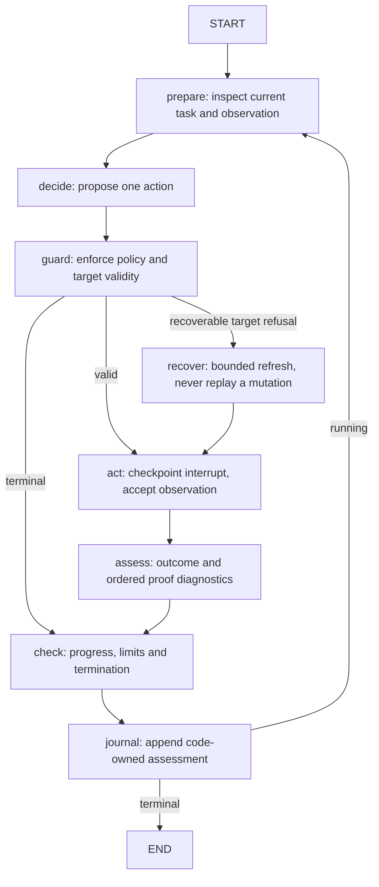

# Walkthru harness rebuild

Created 2026-11-13. Owner instruction: start implementation, increase deterministic harness capability and preserve a reportable decision worklog. This dedicated plan does not replace the existing product backlog.

## Objective and non-negotiable contracts

Complete supported tasks from observed evidence; explain uncertainty, execution refusal and harness failure separately from site defects. The owner objective and safety scope stay fixed. Plans are hypotheses, not evidence. More nodes are justified only by an explicit responsibility, state contract and test.

Keep LangGraph, checkpoint persistence, revision-bound actions, private evidence, admission and free-provider routing. No dependency, relational migration, paid-provider activation, production rollout or destructive-site action is part of this change. Existing dirty work is preserved. Do not resume already-running production checkpoints across a graph rollout without a migration/compatibility trial.

## Target architecture

H4 will add validated task discovery/revision before decide. It must not silently infer a business success condition or reinterpret a failed task as a successful easier one.

## Ordered delivery slices

### H1: Explicit control boundaries and proof diagnostics (implemented locally)
- Split proposal, guard, interrupt/resume and outcome assessment into named graph nodes.
- Expose the current checkpoint's validation problems and last proof rejection to the next decision. Keep old evidence predicates and false-done protection intact.
- Store short, typed factual worklog entries; no hidden reasoning, form values, raw prompts or untrusted model metadata in this log.
- Verify: existing persona, completion, navigation and idempotency tests; graph resume test proves no extra model call on interrupt re-entry.
- Files: persona.py, goal.py, harness.py, schema.py, focused tests. Depends: none.

### H2: Bounded recovery and semantic repetition guards (implemented locally)
- A rejected off-screen/occluded click/type can request one fresh settled snapshot with modern navigation capability; never execute or replay the rejected mutation. A repeated refusal of the same target or two recoveries in a run stops honestly.
- Canonical action signatures ignore scroll/wait fields on clicks, retain relevant parameters for scrolling/waiting, and retain real movement guards.
- Unknown/missing target recovery and viewport-directed reveal remain H4; no guess about which direction reveals an unseen target.
- Verify: recovery success, persistent refusal, absent navigation capability, safety boundaries, irrelevant-parameter variations and real scroll progress.
- Files: persona.py, harness.py, tests. Depends: H1.

### H3: Persist and display the decision worklog (implemented locally)
- Preserve worklog and owner assertion fields across the queued report handoff. Add a bounded optional report JSON field; legacy reports render unchanged.
- Display node/action, checkpoint, reason, progress and status in the shared report and browser print view. It is an execution explanation, not an additional finding or provider chain of thought.
- Verify: job serialization round trip, report schema bounds, sanitization/metadata spoofing, web build/lint and report rendering checks.
- Files: main.py, report.py/schema.py, runs.ts, report worklog component. Depends: H1.

### H4: Grounded task contracts and controlled revision (planned)
- **H4a implemented locally, 2026-11-14:** bounded same-site link destinations now cross the extension/API boundary and reach both providers. Newly model-generated navigation predicates require observed destination support; explicit owner paths and legacy contracts retain their prior semantics. Preparation and assessment expose unsupported-route and section-proof diagnostics. Section links remain unconfirmed pending visibility evidence. No goal rewriting or new model call was added.
- **H4b next:** document identity and section visibility, with independently verified section transitions. Then H4c: bounded discovery/revision and complete task-contract validation. H4 as a whole is not complete.
- Capture sanitized link destinations, document identity and target/section relationships in the extension observation contract; preserve privacy and snapshot bounds.
- Separate route navigation, in-page section visibility and functional outcomes. Track facts, hypotheses, unknown expectations and evidence provenance.
- Validate a plan before execution. Missing expectations enter bounded discovery or an explicit unresolved outcome; they do not become guessed routes. Bind discovered navigation only to observed targets and preserve the original owner outcome.
- Add a bounded revision node with before/after contract events and a reason. Prohibit plan weakening, same-signal double counting and cross-origin evidence.
- Verify on generated path/layout variations, no-route anchors, duplicate labels, unknown outcomes, SPA navigation and negative completion cases. Held-out sites must not appear as source-code branches.
- Depends: H1-H3. Separate browser observation and planner/validator slices; each must stay independently runnable.

### H5: Independent evaluation and attribution (planned)
- Version a capability matrix: route/section navigation, overlays, delayed effects, forms, missing feature, ambiguous objective, visitor boundary and interrupted action.
- Fixtures supply independent expected outcomes, not planner-authored acceptance criteria. Freeze seeds, site state, prompts, model route and environment; split development and held-out tasks.
- Replay recorded decisions to isolate validator errors; scripted browser fixtures test execution; repeated live trials test model+harness behavior.
- Compare current/revised harness with a pinned current model; stronger-model comparison remains separately budgeted. Record fallback attempts rather than conflating provider changes.
- Metrics: correct completion, false done, false failure, safe refusal, recovery success, repeat actions, stage latency, token receipts and total cost per verified success. No reliability percentage from six heterogeneous runs.
- Depends: H4 for release acceptance; baseline fixtures can be added earlier.

### H6: Report claim grounding and release (planned)
- Restrict scanner and summary claims to measured scope; verify summary/top-fix provenance as well as UX findings. Repair categorical SEO/GEO/DNS impact wording.
- Reconcile report and planner/provider token accounting; distinguish expected interrupts from errors in tracing.
- Exercise actual HTTP auth, queue leasing, deployed checkpoint persistence and installed extension. Shadow/opt-in trial before production default. Roll back the new graph only after draining in-flight runs or proving pending-act compatibility.
- Depends: H3-H5. Retain all negative controls; release requires no false-done/safety regression on the fixed suite and improvement on held-out capabilities.

## Worklog and decisions

| Entry | Decision/work | Evidence or consequence |
|---|---|---|
| 2026-11-13 / 01 | Establish dedicated plan; preserve existing backlog and unrelated dirty changes | Six-run audit is the diagnostic baseline, not a benchmark |
| 2026-11-13 / 02 | Start H1-H3 as one bounded vertical capability: explicit graph, safe refresh recovery, persisted explanations | H4 task grounding is still required; this slice must not claim the planner problem is solved |
| 2026-11-13 / 03 | Use deterministic reason codes and allowlisted fields | Prevent model narration or raw page data from masquerading as harness evidence |

Append validation outcomes and remaining limitations after each implemented slice. Runtime worklogs belong in each run/report; this table records engineering decisions.

| Entry | Decision/work | Evidence or consequence |
|---|---|---|
| 2026-11-14 / 04 | Split the graph into eight named responsibilities and pass rejection diagnostics to both provider interfaces | No additional model stage; unchanged ordered proof and safety requirements |
| 2026-11-14 / 05 | Add bounded target refresh and action-specific repetition signatures | Refresh cannot prove completion or replay a refused mutation |
| 2026-11-14 / 06 | Preserve context on normal finish, owner stop and stop retry; render a factual report worklog | Optional report JSON, no relational migration; old reports remain supported |
| 2026-11-14 / 07 | Save a scripted transition demonstration and revised Excalidraw exports | Clearly labelled synthetic inputs; no claim of live-site improvement |

See [the implementation record](harness-rebuild-worklog.md) for exact node input/output contracts, decisions, reproducible examples and remaining gates. [Editable diagram](walkthru-harness-rebuild.excalidraw), [SVG](walkthru-harness-rebuild.svg), [PNG](walkthru-harness-rebuild.png).

## Verification recorded 2026-11-14

- 277 focused API regressions passed across harness, goal, completion, persona, navigation, idempotency, jobs, providers, report trust/contracts and assertions. An additional 11 report-chapter tests passed after regenerating the deliberate optional-field fixture change. Logs: local `tmp/harness-tests.log`.
- Changed Python files and the reproducible demo pass Ruff. Current web production build (including prerender), lint and all 74 web tests pass. `git diff --check` passed for the modified tracked implementation files.
- Three shared serialized-report fixtures now reflect the optional worklog field; an explicit regression verifies reports without that field remain valid.
- The broader full-suite run's final output was unavailable after a session interruption; it is not counted as passing. The focused suite above was rerun to completion against the current checkout. Existing dependency deprecation and tracing warnings did not fail it.
- Diagram exports were visually inspected. Live-site completion improvements, deployed checkpoint/queue compatibility and browser/print visual acceptance are not yet verified. No production rollout was performed.
